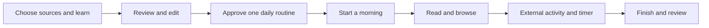

# MORE

**Less phone handling. More of the morning you enjoy.** MORE is a native iPhone prototype: learn from explicitly shared evidence, review one daily routine, approve it, then follow it with useful facts and chosen activities.

**Build from `main`.** The [demo requirements](docs/DEMO-REQUIREMENTS.md), [iOS team guide](docs/IOS-TEAM-GUIDE.md) and [normal iPhone acceptance plan](docs/DEMO-TEST-PLAN.md) define the current scope. Older feature documents retain useful implementation history; their navigation and capability assumptions do not override these guides.



## Current experience

Home, Learn/Routine and Settings are the three persistent destinations. The middle destination opens learning when no routine exists and opens the editable routine afterward. Changes need approval; opening a page or approving does not start a run. Home's date expands days inline. The one saved routine is reused each day.

Cream paper, blue/rust ink, fine sunrise art, one system font family and native SF Symbols form the current direction. The scene follows local time while retaining the app's light paper palette. See [current direction](docs/CURRENT-DIRECTION.md) and [onboarding](docs/ONBOARDING.md). UI/UX work stays in its own workstream.

The first live story is deliberately small: authorized Screen Time → reviewed routine → concise Weather/Calendar opening → Gmail → one feed/article → one external activity with +2/Next → saved recap. The [15-destination catalog](docs/DEMO-REQUIREMENTS.md#integration-catalog) is an expansion map; not every destination has a working inbox or launch adapter.

## Evidence as of 15 October 2026

Runtime baseline: `8e25b20`; demo planning merged at `b8a6c93` without changing runtime. Ordinary MORE 0.1.0 (1518) was installed on the owner's iPhone. The owner confirmed real Google sign-in, unread count, message reading and approval of a Screen Time suggestion. The bundled persistence/reply/run check received “looks good”; that is not separate proof of each step.

The Gmail implementation reported 1,269 package checks with six optional model/media skips; the later learned-Gmail route passed 32 focused checks. Signed native app/widget builds passed. Those results retain their original revision and scope: **actual generated/edited/copied reply, alarm ringing, Siri, Lock Screen +2/Next and a completed ordinary morning still require individual outcomes**. No new phone checks ran for the source audit. [Gmail boundaries](docs/GMAIL-READING.md) · [audit](docs/audit/2026-10-15-IOS-AUDIT.md) · [historical verification](docs/PHASE-ONE.md).

## Build and work together

The app's deployment target is iOS 26. Native full-display recording uses guarded iOS 27 APIs and a compatible SDK. Use full Xcode, your signing team and a paired iPhone; check each feature's hardware, OS, permission and entitlement availability separately.

```sh
./scripts/check-environment.sh
./scripts/test.sh
open MorningOperator.xcodeproj
```

Select the MorningOperator scheme and your phone. The checked-in project can be opened directly; regenerate it with XcodeGen only when project structure changes. Package tests, simulator checks, signed builds and ordinary phone/provider acceptance are different evidence. Follow [onboarding](docs/ONBOARDING.md) for configuration and [the team guide](docs/IOS-TEAM-GUIDE.md) for module ownership, file leases and review gates. Do not merge older Root/Store/design snapshots wholesale.

The iPhone is the product. The Mac is a development/test environment. XCTest phone control is a separate test target and is not a shipped cross-app automation capability.

## Data and Apple models

Current extraction and model inference are local. Screen Time is aggregate evidence; selected video is sampled, not complete tap/scroll history. Native capture is 5–30 minutes with a monitored 256 MiB stop; import is at most 31 minutes/512 MiB with up to 24 sampled frames. These are app bounds, not proof of recognition quality.

Gmail uses explicit read-only Google consent, a private saved refresh credential and volatile message/reply content. It does not send mail or create remote drafts. Calendar, weather, website sessions and each provider's permissions are separate. [Privacy](docs/PRIVACY.md) explains retained copies, forgetting, backup limits and unfinished automatic expiry.

Apple Private Cloud Compute is a future optional route, not implemented access. Its iOS 27 beta API requires managed entitlement and device/service eligibility. Local remains the default; selected text/frames may leave the device only through an explicit permitted choice. Raw recordings stay local by default; no silent remote fallback. [Apple model and recording plan](docs/APPLE-MODEL-PLAN.md).

[Documentation hub](docs/README.md) · [Report feedback](https://github.com/gibouu/morning-operator/issues/new/choose) · [Roadmap](docs/ROADMAP.md)
