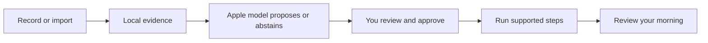

# MORE

> **Build the current app from `main`.** This homepage documents the installed development build; its source was merged into `main` on 13 October 2026 ([#26](https://github.com/gibouu/morning-operator/pull/26), which carried [#22](https://github.com/gibouu/morning-operator/pull/22)).

**Less phone handling. More of the morning you enjoy.**

MORE — MOrning REcap — is an iPhone prototype that turns an explicitly shared glimpse of your morning into a routine you can review, adjust and run. Useful rituals—including messages, browsing and a game of chess—belong in the plan.

[V2 design](docs/V2-DESIGN.md) · [Get started](docs/ONBOARDING.md) · [Teammate handoff](docs/HANDOFF.md) · [Documentation](docs/README.md) · [Roadmap](docs/ROADMAP.md)



## A quieter morning

**App source `1952d9f` is installed and launched on the owner’s iPhone; owner acceptance remains open.** The owner rejected the previous corner-popover design. Source on `main` now centers a shell-free glowing sunrise beneath the plan, reveals four custom-icon actions in a compact native-glass bar, and asks for an explicit Start after Play. Moment durations, concise details and an optional English/French sample sit over a dawn/sunset-inspired background. [PHASE-ONE](docs/PHASE-ONE.md) records actual builds, installations and test outcomes; this description does not establish them.

| Experience | V2 source behavior |
|---|---|
| Morning | A compact date, “good morning” or “bonjour” and total planned minutes sit above tappable tiles showing each moment’s duration. The centered sunrise expands into Play, Learn, History and Settings; Play opens Ready, then explicit Start begins an approved morning. Drafts offer Review; an active run offers Pause or Continue. Tap the background to collapse the dock. There is no permanent tab bar. |
| Arrange your morning | Use native drag on iOS 27, or tap a tile and choose Move earlier/later in its details, while no morning is running or paused. A changed order becomes a draft requiring approval. |
| Review | Tap the date or choose History. Open a seven-day period and its days; revisit dated observations and originals, edit and approve your routine, find saved thoughts, and open settings. The home control returns to Morning. |
| Try a sample | An explicit sample action creates eight editable, manual moments in English or French: calendar/weather, separate messaging apps, Mail, a feed and a thought. It is labeled synthetic, needs approval and has no live inbox access or mandatory meditation. Existing routines are not migrated. |
| Review what was observed | Open sampled moments and their original text, correct one screen label or keep it unknown, and see which labels appeared on distinct days. Your labels stay separate from model proposals. Missing days, unresolved samples and different origins/time zones stay separate. [Observed mornings](docs/OBSERVED-MORNINGS.md). |
| Learn across mornings | Choose up to five dated observations in Review, inspect exact supporting quotations, and approve a separately saved update. Your current routine remains ready during this review. Explicit keep/exclude/timing choices survive later suggestions and can be cleared in Review. [Learning flow](docs/ROUTINE-LEARNING.md). |
| Show your morning | Explicit iOS 27 screen recording, or selected text/image/video import. Local extraction saves separate observations with original text and corrections; identical file imports keep the existing entry. Unknown recording dates stay explicit. Screen recognition and routine suggestions are separate explicit actions; suggestions stay pending until approval. Manual setup also works. |
| Prepare your day | Select calendars and an optional city in Review → Settings → Your day. One sourced recap supplies the visible text and speech; adding it to the routine creates a draft to approve. [Your day](docs/YOUR-DAY.md). |
| Hear a saved moment | Choose a dated excerpt in Review, hear its exact preview and add it to an unapproved draft. Source changes or deletion block replay. [Saved moments](docs/SAVED-MOMENTS.md). |
| Move through it | Supported spoken/calendar/briefing operations advance after completion. Other activities wait for you. The current-moment detail explains its actual purpose and offers Pause or Continue, Next while running, and Again for the supported reading path. A saved completed morning offers Speak, Write or Not now. |
| Begin with an invitation | Set one future notification in Review → Settings; Morning also has a direct clock control on Morning to set or edit it. This is an invitation, not a Clock alarm. Its tap or a foreground Start intent routes into an approved morning, waiting for a ready app. Physical delivery and Siri invocation remain unverified. [Morning entry](docs/MORNING-ENTRY.md). |
| Keep your place | Optional Lock Screen and Dynamic Island progress shows generic categories and passed moments. MORE pauses when you leave; tapping the activity reveals the same morning. Personal text stays in the app. [Lock Screen guide](docs/LIVE-ACTIVITY.md). |
| Speak a command | An explicit on-device English/French turn supports next, pause, resume, skip, repeat and stop. It also accepts the exact English aliases “again” and “read again” for repeat. The exact alias grammar and entry/cancel behavior are tested; real microphone recognition remains a device check. [Voice guide](docs/VOICE.md). |
| Control what stays | Review → Settings → Privacy explains saved copies, disables activity logging and removes local data. Removal resumes after interruption; originals and Apple-app items remain separate. [Privacy guide](docs/PRIVACY.md). |
| Keep what matters | Speak one English/French reflection or write it, edit the words, then explicitly save. The completion invitation never starts the microphone. Review reminder/calendar requests before an optional save to the corresponding Apple app. This is bounded dictation, not an open conversation. |

Review measures **routine runs** and shows source-linked appearances in sampled observations. It does not yet measure complete phone usage or learned app habits. Optional configured Shortcuts log selected app entries/returns with incomplete coverage. [The design contract](docs/V2-DESIGN.md) explains the layout, native controls and metric boundaries.

The interface is available in French and follows the device language ([#32](https://github.com/gibouu/morning-operator/pull/32)). It has not yet been checked on screen or read by a native speaker, and MORE recognizes its own screens by their English text only ([#46](https://github.com/gibouu/morning-operator/issues/46)); [issue #31](https://github.com/gibouu/morning-operator/issues/31) tracks what remains.

## Where it stands

**The sunrise revision is installed and launched on the owner’s iPhone.** The centered sunrise, Ready → Start flow, duration tiles and optional eight-moment sample replace the rejected corner-popover presentation. Long saved observations still run in small sequential analysis requests with progress and cancellation, replacing the 8,000-character whole-input rejection. Review retains observed mornings, day-by-day sampled sequences and exact-quote narration. Design acceptance remains open; [verification](docs/PHASE-ONE.md) is the authority for the final source and results.

| Verification | Evidence |
|---|---|
| Current sunrise revision (`1952d9f`) | Signed, installed and launched on the owner’s iPhone. Six native checks passed, including four built sunrise alternatives in light/dark; one actual largest-text check passed separately. The previous sample/evidence/recovery results retain their earlier source scope. The scoped runs and initial failures are preserved in [verification](docs/PHASE-ONE.md); they are not a new full-suite or physical capture/model result. |
| Long-input learning and evidence | **322 shared checks passed; 6 optional checks skipped.** A final **62-test** focused run passes after the request-wrapper correction. Covers long sources, Unicode, exact offsets, final-batch coverage, cancellation, late failure and rejection of the app's own overview as habit evidence. Model generation/accuracy was not tested. |
| Review navigation | Both corrected native simulator journeys pass: week → day → source → correction/relaunch, and exact quote → preview → explicitly added unapproved draft. Four existing review/home checks passed in the initial run. Initial failures and fixes remain in [verification](docs/PHASE-ONE.md). |
| Earlier physical installation | **`0f94f6d` signed, verified, installed and launched on the owner's iPhone, 10 October**, preserving the user store. No new physical capture, connected-service, model or listener test accompanied installation; the owner walkthrough remains open. |
| Earlier compact interface (`0f94f6d`) | **14/14** native journeys passed in 334.417s; after the final accessible-state refinement, **4/4** regressions passed in 96.905s and largest text **1/1** in 27.329s. All three runs finalized cleanly with no skips. Focused evidence policy **22/22** and voice commands **10/10** pass. [Scopes and warnings](docs/PHASE-ONE.md) remain recorded. |
| Earlier native features | Saved-moment speech progression, fixture-video OCR/recovery, Calendar/Weather preparation, Live Activity, portable files and local forgetting retain separate scoped results in [verification](docs/PHASE-ONE.md). |

**Full-morning accuracy is still open.** Native recording offers up to **30 minutes** with a monitored **256 MiB** size stop; this is a periodic guard, not a guaranteed exact byte ceiling. Import accepts up to **31 minutes / 512 MiB** and samples at most **24 frames** with bounded OCR. Batched text analysis does not establish full-video coverage or measure every scroll, message read or time spent in apps. [The long-recording test plan](docs/LONG-RECORDING-TEST-PLAN.md) and [issue #27](https://github.com/gibouu/morning-operator/issues/27) cover denser, resumable ingestion. The Mac model still reports `modelNotReady`; skipped inference checks are not passes.

The earlier `8a640ea` short real recording reached saved OCR and a draft, but that draft mistook setup text for habits. Targeted guards address the known failure; installing the newer build does not establish physical recognition quality.

The requested short opening, connected inbox counts and social-feed commands are specified in the [product direction](docs/PRODUCT-DIRECTION.md); subscriptions and separate research feasibility are in the [business brief](docs/BUSINESS.md). The [digest protocol](docs/DIGEST-TEST-PROTOCOL.md) defines the next bounded capture → real model → validated facts → speech proof. LEVE is a proposed name with existing App Store matches, not a completed rename. Real microphone/Siri, HomePod and listener-confirmed speech remain open. No issue is closed merely because its source compiles.

## Build on your iPhone

The app targets iOS 26 or later; native recording needs iOS 27. Use full Xcode on the development Mac, your own signing team and a paired phone. The observed physical setup is Xcode 27 with iOS 27.0.1.

```sh
./scripts/check-environment.sh
open MorningOperator.xcodeproj
```

Select the **MorningOperator** target and your phone, then build/run the intended branch. Shared package checks run on the Mac with `./scripts/test.sh`; add `--with-model` only when deliberately testing the available local model. See [onboarding](docs/ONBOARDING.md) for current navigation and [device checks](docs/DEVICE-SETUP.md) for reproducible verification. The [short morning trial checklist](docs/DEVICE-SETUP.md#tomorrow-morning-checklist) retains the earlier recording checks; installation and feature verification remain separate.

The iPhone is the sole active product. The Mac is the development/test machine and optional tethered controller; no separate Mac app is required. The repository, Xcode target and bundle identity retain Morning Operator naming.

## Your data and the model

Extraction and Foundation Models inference run locally. Optional city searches and current weather use Apple Maps and Apple Weather network services; only selected city/calendar settings persist, while recap facts stay in memory. There is no cloud-model fallback, model fine-tuning, billing or research-data upload pipeline. Saved routines, explicit routine choices, the observation archive with original/corrected text and ordered video samples, thoughts and local activity logs have different lifecycles; a finalized app-owned clip can remain for recovery until its extracted text is saved or the person discards it. Review [what is retained and what each clear control removes](docs/PRIVACY.md). Full forgetting removes the app-owned copies and leaves future activity logging off until explicitly enabled; automatic age-based expiry remains future work.

A later, separately opted-in mobile-agent research dataset is a [feasibility question](https://github.com/gibouu/morning-operator/issues/24), not current collection behavior.

## Explore the project

| Read | For |
|---|---|
| [Documentation hub](docs/README.md) | Find the right guide quickly |
| [Teammate handoff](docs/HANDOFF.md) | Current build, known failures, issue coverage and three next tasks |
| [Digest test protocol](docs/DIGEST-TEST-PROTOCOL.md) | Fresh seeds, withheld truth, per-app checks and five independent days |
| [Business hypotheses](docs/BUSINESS.md) | Initial customer, subscription/voice/integration experiments and separate research feasibility |
| [V2 design contract](docs/V2-DESIGN.md) | Morning/Review, completion capture, native glass and honest metrics |
| [Your day](docs/YOUR-DAY.md) | Calendar/city selection, prepared speech, freshness and source privacy |
| [Saved moments](docs/SAVED-MOMENTS.md) | Exact historical excerpts, native speech, approval and changed-source refusal |
| [Morning entry](docs/MORNING-ENTRY.md) | One-time invitations, foreground Start, permissions and delayed-entry fallback |
| [Architecture](docs/ARCHITECTURE.md) | Components, states, data flows, model boundaries and Apple integrations |
| [Recording benchmark](docs/OBSERVATION-BENCHMARK.md) | Reproduce the controlled cross-app capture and inspect its measured limits |
| [Routine learning](docs/ROUTINE-LEARNING.md) | Saved mornings, exact quotations, pending proposals and approval |
| [Privacy & local data](docs/PRIVACY.md) | Inventory, full forget, recovery, external copies and unfinished expiry work |
| [Routine files](docs/ROUTINE-FILES.md) | Review a portable plan before saving or importing it; notes stay out by default |
| [Observation plan](docs/OBSERVATION-PLAN.md) | Consent, evidence, cycles, unknowns and multi-day learning |
| [Verified phone results](docs/PHASE-ONE.md) | Actual physical device/build/test evidence and open checks |
| [Roadmap and issues](docs/ROADMAP.md) | The next product slices and collaboration plan |
