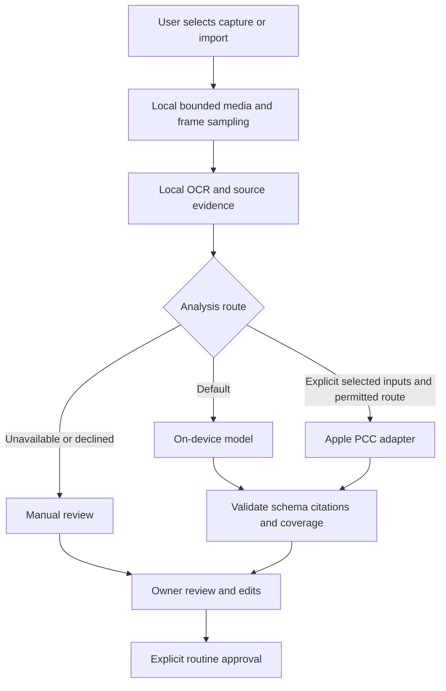

# Apple model and recording plan

15 October 2026 · Future adapter plan · Related #2, #23, #27, #29 and #161.

MORE keeps recording and analysis local by default. The current app uses on-device Foundation Models and local media extraction. An optional Apple Private Cloud Compute route can extend analysis after its public API, entitlement, device, privacy and quality gates pass. It is not implemented or granted in this project today.

Private Cloud Compute runs inference. It does not provide iCloud/CloudKit storage, device backup, account sync or the app's deletion policy. Those are separate decisions.

## Current and future routes

| Route | Appropriate use | Required gate |
|---|---|---|
| Deterministic local extraction | File validation, frame timing, Vision OCR, numeric browser observations and source references | Bounded input, real capture status, cancellation and local storage lifecycle. This can remain useful when a language model is unavailable. |
| On-device Foundation Models | Short summaries, source classification, routine proposals and editable reply text | Supported device/region/language, Apple Intelligence ready, model availability, bounded context and schema validation. Current app route. |
| On-device images | Selected-frame interpretation through the documented iOS 27 multimodal API | New guarded adapter plus physical-device quality tests. It is not enabled merely because existing OCR works. |
| Apple Private Cloud Compute | An explicitly chosen deeper analysis of selected evidence | iOS 27+ API availability, managed entitlement/provisioning, eligible account/device, network and daily quota. Current Apple documentation is beta/preliminary. |
| Shortcuts Use Model | A separately configured user Shortcut passing approved inputs/results through App Intents | The person chooses the model route in Shortcuts. An App Intent is not itself the app's PCC transport. |
| Manual review | Correct extraction or assemble a routine when inference cannot run | Keep observations and corrections usable. Never replace missing evidence with fabricated model success. |

Apple documents `SystemLanguageModel` as on-device and a 4K session context. Context includes instructions, prompts, schemas, tool data and output; app character/byte limits are not token counts. Select bounded evidence and handle context errors. [System model](https://developer.apple.com/documentation/foundationmodels/systemlanguagemodel), [context management](https://developer.apple.com/documentation/foundationmodels/managing-the-context-window).

The documented direct PCC route uses `LanguageModelSession(model: PrivateCloudComputeLanguageModel())`, with a larger 32K context and network/daily-usage constraints. Check model availability rather than assuming an eligible OS guarantees access. Apple's current managed-access criteria and the project's grant remain separate checks. [PCC integration](https://developer.apple.com/documentation/foundationmodels/adding-server-side-intelligence-with-private-cloud-compute), [model API](https://developer.apple.com/documentation/foundationmodels/privatecloudcomputelanguagemodel), [managed access](https://developer.apple.com/private-cloud-compute/).

On iOS 27, Apple documents image attachments including image objects, pixel buffers and image files. A recording is not a documented whole-video model attachment: select frames with timestamps. Frame count/rate/pixels/bytes are app budgets to evaluate. [Multimodal prompting](https://developer.apple.com/documentation/foundationmodels/analyzing-images-with-multimodal-prompting), [attachments](https://developer.apple.com/documentation/foundationmodels/attachment).

## Proposed processing boundary

Keep these responsibilities separate inside the existing packages; they are proposed logical boundaries, not a request to create many frameworks at once.

| Boundary | Receives and returns | Rules |
|---|---|---|
| Capture pipeline | User-selected source → owned local media plus capture-status/time metadata | Own capture lifetime, size/duration monitoring, temporary files, cancel/retry/discard and privacy generation. No model calls. |
| Evidence preparation | Selected media → bounded frames/OCR/observations | Preserve frame IDs, timestamps, blank/missing/truncated coverage and original/corrected text. No side effects or cloud routing. |
| Model gateway | Prepared evidence + purpose + requested route → typed proposal or typed failure | Own model capability/context limits, fresh session, cancellation and route provenance. Do not receive arbitrary file-system access or provider tokens. |
| Proposal validation | Model output + authoritative source IDs → accepted candidate or refusal | Validate schemas, exact citations, timing/order bounds, uncertainty and the current privacy generation. A plausible sentence is not evidence. |
| Review and approval | Candidate + owner edits → approved immutable version | Models cannot approve, send a reply, open a target or mutate the live session. |

The UI observes a clear state such as idle, capturing, processing, review, failed or cancelled. Services exchange immutable `Sendable` values and own their asynchronous lifetimes. Avoid moving heavy work into a view or assuming `@MainActor`/an actor makes synchronous file work cheap. [SwiftUI model data](https://developer.apple.com/documentation/swiftui/managing-model-data-in-your-app), [Sendable](https://developer.apple.com/documentation/swift/sendable).

## Recording coverage

Current app limits are a 5–30 minute native capture with a monitored 256 MiB stop, and selected-video import up to 31 minutes/512 MiB with at most 24 sampled frames. The periodic size monitor is not an exact hard byte ceiling. Sparse frames cannot prove every click, missed call, message read or scroll speed. Keep the coverage with every interpretation.

Apple's current iOS 27 ScreenCaptureKit path uses the system content-sharing picker and supplies sample-buffer frames. Current-app and full-display capture are distinct; background capture needs the appropriate supported mode. Handle blank, idle, suspended and stopped status without inventing “no activity.” Older ReplayKit/app recording is a separate capability path with media limitations. [iOS capture](https://developer.apple.com/documentation/screencapturekit/capturing-screen-content-on-ios), [frame status](https://developer.apple.com/documentation/screencapturekit/scframestatus/blank), [ReplayKit](https://developer.apple.com/documentation/replaykit).

## Privacy and model safety

- Keep raw videos local. Default cloud input is empty. Before a PCC request, show the purpose and selected categories/frames or text that will leave the device; the person can stay local or cancel.
- Gmail, Health and recording permissions do not themselves authorize model/cloud processing of every item. Scope the selected analysis separately.
- Keep trusted static instructions separate from untrusted emails, page text, OCR and images. Attach no action tools for interpretation; use explicit disallowed-tool mode where supported. Validate generated structures and source references before review. [Apple tool calling](https://developer.apple.com/documentation/foundationmodels/expanding-generation-with-tool-calling), [model safety](https://developer.apple.com/documentation/foundationmodels/improving-the-safety-of-generative-model-output).
- Preserve route/model/OS version and coverage in local evidence metadata; exclude raw content from diagnostics. A PCC result does not automatically authorize retaining additional input copies.
- A local-only request never falls back to cloud. A failed PCC request may offer local/manual processing only if the prepared evidence fits that route. Report reduced coverage; do not silently submit data to another provider.
- Cancel/Forget invalidates pending results and temporary media using the existing privacy-generation boundary. Apple PCC request handling does not replace MORE's own cleanup. [PCC security requirements](https://security.apple.com/documentation/private-cloud-compute/corerequirements).

## Validation before enabling a route

1. Confirm supported SDK/OS APIs and signed entitlements. A declared plist key is not an entitlement grant. Preserve an older-OS local/manual path.
2. Test the physical picker, permission/cancel, full-display/current-app scope, background, lock, process termination, blank frames and interrupted cleanup. Simulator compilation is not capture or Vision proof.
3. Test size/duration/frame/pixel/token bounds, changed-file identity, cancellation at each stage and late completion after Forget.
4. Use a labeled corpus of harmless recordings. Compare extracted facts, source citations, unknowns and proposed order against withheld truth. Report partial coverage and actual model failures. Re-evaluate after OS/model updates. [Apple evaluation guidance](https://developer.apple.com/documentation/foundationmodels/evaluating-prompts-to-measure-performance-and-improve-model-responses).
5. Test local model not-ready/unsupported-language/context/refusal cases. For PCC also test absent entitlement, ineligible device/region, offline, service/quota errors, cancellation and a real signed TestFlight/ad hoc response. Do not count Xcode's quota simulation as a live PCC response.
6. Measure latency, peak memory, battery/thermal behavior and saved media growth on representative devices before expanding observation length or adding background work.
7. Update privacy disclosures, retention/backup decisions and reviewer instructions to match actual behavior before distribution. Public API availability is separate from App Store acceptance.

Next slice under #29: a gated adapter evaluation with harmless selected text/frames, followed by real device and entitlement evidence. The core demo remains viable through local extraction, on-device inference where ready, and manual review when unavailable.
