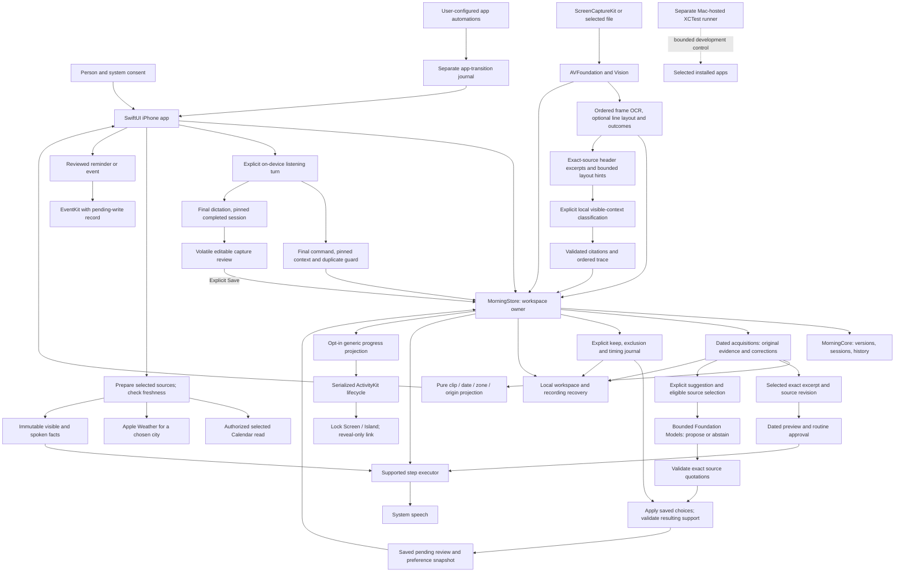
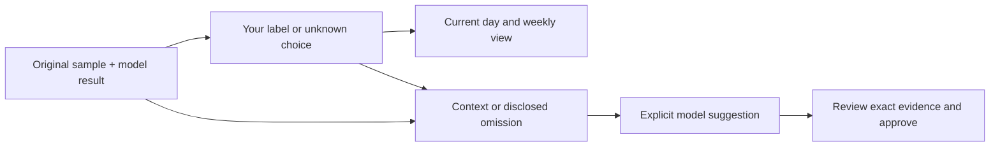
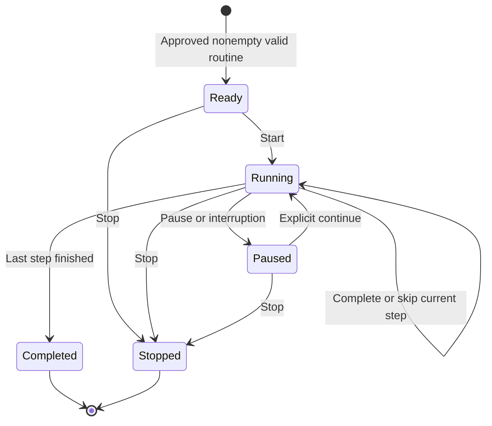
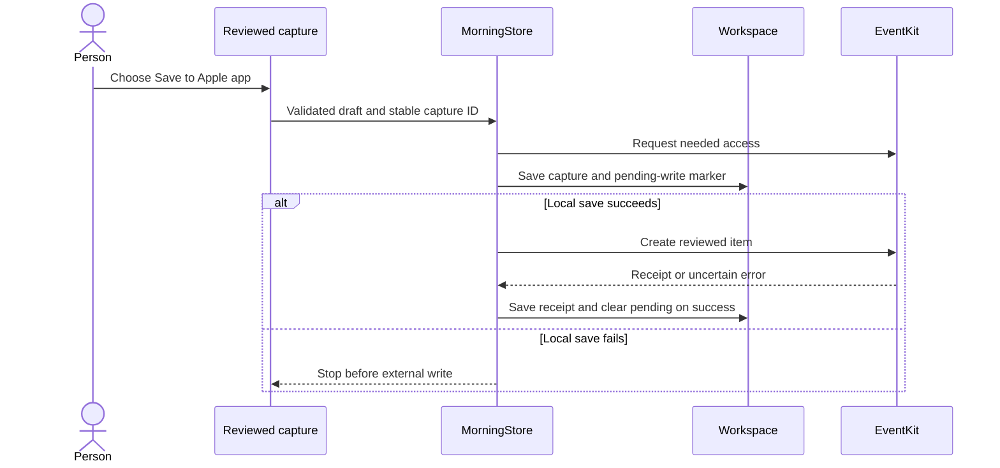

# System architecture

MORE is an iPhone app for observing a deliberately shared part of a morning, proposing a routine and helping the person run supported steps. The current implementation is local and has no backend or third-party runtime packages. The Mac is a development/test host and optional tethered controller; there is no separate Mac product target.

This guide describes source architecture and its limits. [PHASE-ONE](PHASE-ONE.md) is the authority for actual test results; [the roadmap](ROADMAP.md) separates upcoming work. MORE (MOrning REcap) is the V2 display name; the bundle, repository and Xcode target retain Morning Operator identities.

Three distinct source paths reach the routine. Imported or recorded evidence can support a **model-proposed draft**, which needs cited support and approval. An explicitly selected **saved excerpt** supplies deterministic, dated narration with a reference checked on every playback. **Your day** supplies fresh selected Calendar/Weather facts with an expiry. None grants arbitrary app control. See [routine learning](ROUTINE-LEARNING.md), [saved moments](SAVED-MOMENTS.md) and [Your day](YOUR-DAY.md).

Controlled recording/import and synthetic native UI checks have scoped evidence. Successful local model recognition and its semantic accuracy remain unverified on the intended phone. The complete versioned test history, including earlier failures, is kept in [verification](PHASE-ONE.md) and the [benchmark](OBSERVATION-BENCHMARK.md).

## Components and boundaries

There is no app-runtime connection from the model to arbitrary phone controls. Recording can expose visible content; it cannot itself send a tap or grant access to an app's private data. The XCTest runner is a separate execution environment, not an entitlement held by the installed product.

| Module | Responsibility | Main source |
|---|---|---|
| `MorningCore` | Codable domain objects, recording/fingerprint metadata, routine/session invariants, preference journal/reconciliation, portable plan validation, timing/history, atomic JSON and action-journal primitives | [Core sources](../Sources/MorningCore) |
| `MorningApple` | Observation acquisition/archive validation and derived review, media extraction, local file fingerprints, evidence filtering, local inference, recording/recovery, speech, selected Calendar/Weather preparation, reviewed EventKit writes and transition storage | [Apple adapters](../Sources/MorningApple) |
| iPhone application | Views, one main-actor workspace owner, lifecycle coordination and App Intents | [App sources](../Sources/MorningOperator) |
| Live Activity extension | Generic category/status/count presentation from bounded Core content; no workspace, personal strings or external effects | [Widget source](../Sources/MorningActivityWidget) |
| Development harness | Isolated synthetic journeys, selected external-app checks and dedicated observation-benchmark fixture targets | [UITests](../UITests), [fixture apps](../Benchmarks/FixtureApps) |

The project targets iOS 26. Native ScreenCaptureKit recording is guarded for iOS 27; selected-file import remains available on the older baseline. Shared package checks target macOS 26 or later. Availability declarations do not replace actual device/model/permission checks.

`MorningBenchmarkInbox`, `MorningBenchmarkCalendar` and `MorningObservationBenchmarkUITests` belong to a dedicated benchmark scheme. Their synthetic inbox/calendar content and controller are not embedded in the shipping `MorningOperator` app; the ordinary UI-test target excludes the benchmark controller. These targets support a controlled comparison, not a runtime permission to control other apps.

## Capture, recover, extract

The person chooses **Record a little of my morning**, selects a duration and confirms Apple's picker. The current UI defaults to **20 minutes**, with 5/10/20/30-minute choices and a 256 MiB bound. This is an elapsed-time cap, not detection of inactivity. The stop request and confirmed stream/file completion can happen at different times.

```mermaid
stateDiagram-v2
    [*] --> Idle
    Idle --> SystemPicker: Person starts
    SystemPicker --> Starting: Person shares
    SystemPicker --> Idle: Cancel
    Starting --> Recording: Capture acknowledged
    Recording --> Stopping: Stop, limit or interruption
    Stopping --> Stopping: Stop uncertain; retain owner and retry
    Stopping --> SavedClip: Confirmed stop and finalized file
    SavedClip --> Extracting: Readable metadata; foreground and idle
    SavedClip --> RecoveryAttention: Existing metadata unreadable
    RecoveryAttention --> SavedClip: Metadata repaired; explicit Retry
    RecoveryAttention --> Idle: Explicit discard
    Extracting --> SavedClip: Blank, OCR, cancellation or save failure
    Extracting --> SavedText: Readable text and frame evidence saved
    SavedText --> NeedsReview: Review evidence and confirm missing provenance
    SavedClip --> Idle: Explicit discard
```

`ScreenRecordingService.shared` owns the stream independently of sheets. Its finalization callback stages a successfully finalized clip into one durable recovery slot before releasing ownership. The foreground coordinator starts same-session extraction only when the app is active, no analysis or routine session is in progress, and review/settings/capture/voice surfaces are unoccupied. It retries that eligibility check after those surfaces close. A clip recovered after app relaunch requires **Retry**; relaunch does not silently reprocess it.

Import, retry and same-file reimport stop after saving/selecting evidence; they do not call the model. Recording completion queues Learn review until extraction is idle and the active app can present it. Review readiness is observed separately from Start occupancy: pending raw recovery cannot block its own review, and ending a session can resume a queued request. A Morning notice dismisses before Learn opens; imported-text review and saved-recording Retry/Discard remain available without ScreenCaptureKit, including in the simulator. Processing disables recovery actions. The person reviews the text, confirms missing date/origin and explicitly requests a suggestion. This keeps acquisition, inference and approval as separate actions, including for the first routine.

The app closes its own Record/Learn sheets when it can handle acknowledged capture in the active scene. Apple's sharing panel is a separate system surface: it remained visible seven seconds into an observed clip. Automatic dismissal is not established. Use the system's normal dismissal/navigation controls; do not interpret an open panel as proof that capture has not started.

Non-user interruption can retain a successfully finalized clip with a coverage note. An unfinalized/writer-failed file is not treated as a usable recording. Stop errors keep resources/status for retry; a failed ownership handoff keeps the service's file rather than silently losing it. These source protections still need broad hardware coverage across interruption, locking and limits.

The importer reads a selected image, video or UTF-8 file with scoped file access. Video is capped at 512 MiB and 31 minutes in current source, allowing a small completion margin around the 30-minute recording option. AVFoundation requests at most **24 frames**. One extraction pass retains a stable per-request ID, requested/actual timestamp or labeled fallback, OCR text, blank/decode/OCR outcome and warnings. A 30,000-character/256,000-byte OCR budget leaves room for labels within 32,000 rendered characters. Truncated/omitted text is explicit and cannot support context identification. Notes deduplication never removes the original structured samples. Supported native decoded frames now also retain original rational CMTime fields (`ObservationMediaTime`) alongside decimal seconds, including blank/OCR-failed/truncated frames. Legacy absent fields remain absent; inconsistent optional restored timing is omitted with a warning without changing original text or citations. No media span or wall-clock mapping is inferred.

The same Vision pass now adds optional `ObservationOCRLine` records: stable local line IDs, exact text and Swift Character ranges, candidate recognition confidence, and approximate candidate-range bounds in normalized lower-left image coordinates. Bounds describe the oriented decoded image, not exact glyph outlines, tappable controls or verified app identity. Core validation rejects invalid bounds/confidence, duplicate IDs, unordered or overlapping spans, and text that differs from the exact source; decoding repeats validation. At most 256 line records are retained per frame. Legacy frames with no layout field decode with `nil`; an empty or partial array does not establish complete layout coverage. [Apple candidate-range bounds](https://developer.apple.com/documentation/vision/recognizedtext/boundingbox(for:)).

The adapter preserves the existing trimmed-line order and newline-joined OCR text before extraction limits. Missing/invalid/capped geometry produces warnings while keeping that text; bounds are not clamped or guessed. If the text budget clips a line, only unchanged whole line records that fit the retained prefix survive. Source-truncated frames remain ineligible for context identification.

Bounded OCR bodies, optional line layout and frame metadata are saved with each accepted observation acquisition in the workspace; sampled pixels are not persisted. All-blank extraction returns diagnostics to its caller, but the store preserves the previous observation and keeps an owned raw clip for retry rather than replacing good evidence with empty text. The whole video can contain activity absent from the samples. File duration does not declare wall-clock capture start or complete continuous coverage. [Detailed evidence contracts](OBSERVATION-METRICS.md).

The observed real clip proved capture → OCR → saved text → visible unapproved draft and readable text after ordinary-app relaunch. It also produced incorrect habits from setup/marketing text. The updated policy now rejects the same saved text in a deterministic local replay, without a new model call or changing the original text. This demonstrates why transport, visibility and semantic correctness need separate checks. [Apple iOS capture sample](https://developer.apple.com/documentation/screencapturekit/capturing-screen-content-on-ios), [Vision text recognition](https://developer.apple.com/documentation/vision/recognizetextrequest).

## Observation acquisitions and dates

The workspace now holds an `ObservationArchive` and a selected acquisition ID. Each acquisition retains its original text, optional original video evidence, optional current correction and validated classification. Learn projects the selected acquisition into its editor; importing another readable file adds/selects an entry without deleting earlier observations. Review offers the archive, dated day details and a separate **Date needed** collection. This retains evidence across mornings; it does not yet calculate an observed-habit average.

`importedAt` records import time separately from an optional observed date and its time-zone/provenance. Native `ObservationRecordingContext` contains a session UUID and the wall-clock instant/time zone observed at the recording-output start callback, captured before the main-actor hop. Recovery retains it across retries; successful import now saves it as immutable acquisition metadata independently of the editable observed date. The recorder releases only its live copy when transferring/discarding the clip or beginning a new session. The archived copy remains until its observation is deleted. This is not a physical-pickup signal or exact alignment with video PTS zero. A file import or legacy observation has no observed date by default; neither file dates nor media timestamps supply it. The person can explicitly assign/change the observed day and zone. Origin separately records human, automated, synthetic or unknown activity; recording alone does not prove a human origin.

`ObservationFileFingerprintService` reads the explicit local file with CryptoKit SHA-256 in 1 MiB chunks, with a 512 MiB limit, cancellation and file-change checks. The importer checks the digest again after extraction before committing evidence. Exact-byte reimports select the existing acquisition and retain its identity, corrections, dates and origin. This is deduplication, not semantic equivalence or proof of media authenticity. No source path, file contents or raw file errors are logged by the fingerprint service. Its result contains SHA-256 and byte count; the archive retains SHA-256. The acquisition's local source label can still contain the selected filename.

Notes corrections change the text used for routine suggestions while preserving original text and original frame evidence. Editing notes removes attached classification and per-screen reviews; reverting the correction does not resurrect it. A source correction, date/origin change or deletion invalidates a pending routine update that depends on that source. Unsupported saved derived classification can be dropped with a warning while preserving valid original evidence. Delete one/Delete all removes archived observation evidence after a successful workspace save, without deleting routines, their existing quotations, run history or a raw recording awaiting recovery. Manual edits save at editing/lifecycle boundaries and before import/analysis; failed writes retain edits and keep owned raw media available for retry.

The archive is bounded and rejects an addition that exceeds its limits instead of silently evicting an older observation:

- At most **60 acquisitions**.
- Original text at most **33,000 characters**, including an optional bounded recording-coverage prefix; a correction at most **32,000 characters**. Each text field is also capped at **300,000 UTF-8 bytes**.
- At most **8 MiB of aggregate text** across original/corrected text, frames, OCR lines and prepared excerpts, plus **20,000 OCR line records**.
- At most **16 MiB of compact-encoded archive JSON**. This is an archive validation limit, not a bound on the whole formatted workspace file and its other data.

Records and selected ID share the existing schema-1 workspace's atomic save. Legacy single-observation data migrates with unknown import/observed dates; acquisition identity is saved once migration succeeds. Same-ID inserts with conflicting source/digest are rejected; the same text without a file digest is not automatically treated as the same acquisition. Raw recovery remains one separate slot, not a video library: only a successful archive/workspace save or an explicit discard permits removal of its video and metadata. A crash after the workspace save but before raw cleanup can reselect the existing digest on retry.

### Per-sample user review

`ObservationFrameReview` is a bounded label plus exact saved quotation, or an explicit unknown choice, with a sample ID and review timestamp. The acquisition validates its relation to current original evidence and retains original classifier output independently. The review projection overlays it with explicit user provenance; stable identities use a separate namespace so user and inferred labels never merge silently. Tied/conflicting moments, zones, origins and missing coverage keep the same conservative treatment.

A stale editor cannot save against a changed acquisition. Archive mutation and workspace persistence either retain the reviewed value or restore the previous in-memory archive on failure. Note correction clears screen reviews; date/origin/classification changes and exact-file recovery enrichment preserve them. Invalid restored reviews remove the whole overlay and classification with a warning, leaving original evidence available; this avoids reviving an interpretation that an unreadable unknown choice may have rejected. The recovery warning blocks both original-video proposal preparation and restoration of a pending proposal. An explicit broader written correction supplies an independent user report and can be learned.

Screen reviews enter the learning source revision. Nonempty review arrays add bounded, separately encoded context to eligible original OCR units; unknown samples become disclosed omissions. Original quotes, offsets and activity eligibility remain authoritative. Saving a review never performs inference or grants an operation. Saved-moment speech remains bound to original quotation/date bytes; a label alone does not change those spoken words.

## Proposed updates from saved observations

Learn prepares its selected acquisition for the same pending-proposal operation used by **Review → Saved observations → Choose mornings**. The latter selects one to five dated acquisitions independently of Learn's selection. All selected sources must share a time zone and be either human observations or synthetic samples; the two origins cannot mix. Learn's **Confirm this observation** / **Day and source** form records missing provenance explicitly. Native recording dates do not imply human origin, and import time does not supply an observed day. Undated, unknown-origin and automated entries remain reviewable but cannot pass suggestion preparation.

Preparation uses the current correction as an explicit user report, or the original text/eligible original video frames. Source identities, revisions, dates, origins and frame identities stay in an app-owned mapping. Excluded or truncated frames are disclosed as omissions; every selected acquisition must contribute eligible input. A selected source need not produce an accepted model suggestion, so selection counts are not support or coverage counts.

The saved-observation operation processes all eligible text from one to five bounded saved sources in serial native requests. Each prompt has at most **1,500 characters and 6,000 UTF-8 bytes**, including identifiers and review metadata; the whole operation no longer has an 8,000-character cutoff. A defensive ceiling of 768 requests bounds exceptional input. Trusted instructions, schema and output are outside the prompt budget. Exact source quotations, unit identities and offsets survive batching; validated request completion drives visible progress. Cancellation or any failed request produces no partial proposal and leaves the current routine unchanged. Matching proposed titles/categories merge their separate citations; overflow is explicit, never silent truncation. The final candidate still permits at most **ten moments**, including kept rituals, with up to 512 citations and 32,000 detail characters per moment. These are input/output safeguards, not a claim of exhaustive video extraction or measured app use. Generated steps have no executable operation.

One unapproved `EvidenceRoutineProposal` is saved alongside the sources and unchanged current routine. Review shows exact quotations, source layers, omitted samples and a collapsed comparison with the current version. Dismissal/relaunch keeps it pending. Learning-relevant source, base-routine and preference-journal revisions are rechecked on return, persistence, restore and approval; a dependent source, base or choice change invalidates it. Recording-start context is deliberately excluded from the source revision because it changes neither the learner's text nor the assigned observed day. The proposal stores the captured optional journal and its full digest. Restoring a current proposal also replays reconciliation, compares complete resulting steps and validates the user-choice support IDs; a forged exact-ID timing match cannot change its title/category. A failed or canceled new analysis does not replace the existing routine or an otherwise valid pending proposal.

**Approve update** atomically saves the approved version, previous approved version, ready session and removal of the pending proposal. Failed persistence restores those in-memory values for retry. An active or paused run blocks generation/replacement and keeps its pinned version. Approval does not start a run or dispatch effects. **Keep current** removes only the pending proposal. See [the learning guide](ROUTINE-LEARNING.md) for the full review and retention contract. This is explicit evidence review, not a computed habit average or automatic daily adaptation.

## Foundation Models: inference, not training

`AppleIntelligenceService` checks `SystemLanguageModel.default.availability`. If the device is ineligible, Apple Intelligence is disabled or the model is not ready, the app shows the reason. Manual routines and review remain available. There is no silent cloud fallback.

**Planned provider boundary, checked 10 October 2026:** iOS 27 adds a direct `PrivateCloudComputeLanguageModel` API, distinct from the on-device model and from Shortcuts' Use Model action. A future adapter must check its own availability/quota and account entitlement, require explicit cloud/source consent, and retain the same quotation, revision and approval validation. No PCC adapter, entitlement verification or upload is implemented here. Image attachments make a bounded frame-plus-OCR evaluation possible; a recording is not automatically an understood sequence. The local path remains usable without cloud consent. [PCC model](https://developer.apple.com/documentation/foundationmodels/privatecloudcomputelanguagemodel), [managed eligibility](https://developer.apple.com/private-cloud-compute/), [image prompting](https://developer.apple.com/documentation/foundationmodels/analyzing-images-with-multimodal-prompting).

The current evidence-policy revision separates user-reported activity from visible task content. It filters whole visual frames before chunking, rejects recognized setup/picker/launcher/marketing contexts, and allows an insufficient-evidence outcome. This is a targeted, incomplete heuristic. Rejection by that deterministic prefilter happens before model inference; it is distinct from the model returning its own insufficient-evidence outcome. Deterministic guard tests do not establish real-model abstention. The validation record is in [PHASE-ONE](PHASE-ONE.md).

Learn's **Suggest a routine** / **Suggest an update** and the multi-selection action now use the same preparation and per-request batching limits above. Independent source identities remain distinct even when their text matches. Dynamic guided-generation schemas constrain outcome, step category, evidence kind, quote and tentative duration. Post-generation checks require valid source-unit identities, exact supporting quotations, valid kind/duration and matching evidence type. Assembly merges matching titles/categories and their citations without averaging durations. The result remains **unapproved and pending**, with no inferred execution operation; only explicit approval installs it.

A matching quote proves only that text appeared in the input. It does not prove that the person opened an app, read a message, performed the activity or repeats it daily. A screenshot is a moment. Durations generated by the model are suggestions, not measurements. Source text is untrusted data and cannot approve a plan, change consent, invoke an external tool or override app policy.

The separate `ObservationContextClassifier` is explicitly invoked from Learn's **Recognize sampled screens** control. It preserves the original ordered frames and selects a contiguous, unmodified OCR prefix of at most **320 characters and six whole nonempty lines** from each eligible frame. An overlong line ends selection; later text is not substituted. These excerpts, IDs and media times enter bounded native-model batches, independently of routine-learning deduplication. Full bounded source OCR and exact stored geometry remain saved. The `whole-line-source-prefix-layout-v2` preparation policy can add at most six layout hints whose complete line spans lie in the selected prefix. Hint coordinates and OCR confidence are rounded to six decimal places; exact source values stay unchanged. Optional hints are removed before excluding text if a single-frame prompt would exceed its limit. `inputSelection` records the policy, source lengths, selected offsets, excerpt text and selected line IDs; older saved classifications can omit this metadata, and its presence does not imply a model request occurred.

Validation binds each accepted decision to its exact sample ID, media time, source reference and a quote present in both the selected excerpt and original frame. The context classifier and trace adapter compare quotation UTF-8 bytes, rejecting canonically equivalent Unicode rewrites that only look identical. Blank, failed, source-truncated, omitted or over-budget frames remain unknown. Deliberate header selection is distinct from source truncation. Classification is saved with its acquisition and revalidated after reload; editing that observation’s notes removes its classification and per-screen reviews. Selecting/importing another acquisition leaves earlier entries intact. Cancellation plus evidence/acquisition-ID checks prevent a stale result from attaching to another import.

These are `visual-context:` labels, not verified app identities. Generic early-header matching can see Inbox → Alex → Inbox inside one app. Catalog matching permits leading punctuation/symbol decoration, but competing catalog mentions block identification and alphabetic OCR damage is not repaired. Neither rule proves foreground-app identity. Layout hints do not relax these checks or let a high/large text region resolve competing catalog names. Learn therefore displays recognized appearances rather than OS entry or scroll counts.

The earlier text-only preparation replay retained all **24 baseline samples**, selecting **2,217 characters**, without changing the saved full source. This is input eligibility, not successful classification. The earlier Mac attempt reported **model not ready, with zero requests**. A subsequent simulator attempt reported availability, then **six failed requests, zero responses and 24 unknown decisions**. The app process's native log reported `operationNotAllowed: Simulator is not supported` in a required backend. That is a runtime support failure, not evidence that the synthetic content violated a policy or that the model abstained. No physical-device context-model benchmark has run. Earlier phone routine-generation results remain separate evidence. [Observation metrics](OBSERVATION-METRICS.md), [benchmark record](OBSERVATION-BENCHMARK.md).

“Learning” currently means interpreting explicitly supplied evidence and saving reviewed routine versions/preferences. No fine-tuning, adapter training, weight update, persistent model memory, embedding index or research corpus is implemented. Future four/five-day estimates and continuous per-morning adaptation belong to [#11](https://github.com/gibouu/morning-operator/issues/11) and [#21](https://github.com/gibouu/morning-operator/issues/21); they need evidence and ordinary data aggregation, not a claim that the foundation model retrains each morning. [SystemLanguageModel](https://developer.apple.com/documentation/foundationmodels/systemlanguagemodel), [guided generation](https://developer.apple.com/documentation/foundationmodels/generating-swift-data-structures-with-guided-generation).

## Routine and session state

`RoutineVersion` contains ordered `RoutineStep` records. Edits create an unapproved version; one prior approved version is retained and can be restored while no run is active. Approving a saved-observation update also preserves the previous approved version for that control. This is not a complete version-history browser. A run pins a snapshot of its approved version.

`RoutinePreferenceJournal` persists explicit Keep, Exclude and duration choices independently of the current routine. The controls live in **Review → Your routine** and **Review → Your routine → Saved choices**. Keep stores the full user-owned moment; duration-only entries apply 1–120 chosen planned minutes to a matching generated activity without inserting it when absent. Exclusions prevent a matching row from returning. Exact target IDs take precedence over a unique case/whitespace-normalized title plus category; fuzzy/synonym matching is absent, and ambiguity/conflicting choices stop reconciliation. The journal is bounded to 100 entries and 4 MiB encoded data without eviction.

The app passes an authoritative journal, even when empty, after sanitizing generated required/operation flags. A cleared Keep cannot be recreated from the base routine's old `isRequired` value. Shared API `preferences: nil` remains the legacy required-retention mode for older callers; an explicit empty journal is distinct. Only a workspace where the journal field is missing migrates existing personal required moments into Keep snapshots. It does not infer optional timing/removal choices or migrate demonstration rituals. Present-but-null and malformed journals retain their JSON values and unknown fields through unrelated saves, preserve routines and observations, and block suggestions/approval until a confirmed reset in Review.

Removing a row from the current draft leaves standing future choices intact; excluding it also creates a tombstone. Clearing a choice changes future suggestions without changing the current routine or archived runs. Restoring a previous routine also leaves standing choices intact. Step edits and journal changes save together; persistence failure rolls them back. A full kept moment is labeled as a preserved user decision without new observation citations. A generated moment with an explicit timing override retains its exact source citations and a separate user-timing receipt. This is a current preference set, not a complete edit-history log or model training. See [the learning guide](ROUTINE-LEARNING.md#saved-choices-in-review).

An unapproved/empty/invalid routine cannot start. A repeated advance command ID cannot skip two steps. Pause, stop and manual advance cancel the current execution attempt; stale callbacks cannot advance another session or step. A running checkpoint restored at launch becomes paused, and its interrupted duration is unknown rather than including unobserved time.

Automatic progression uses explicit `RoutineStepAutomation` operations: `spokenNote`, `todayCalendar` and `morningBriefing`. A generated category such as messages/calendar is not an operation. Other steps wait for the person's Next. Speech completion proves synthesis finished; it does not prove the person heard it or performed a real-world activity. A sourced moment pins an immutable prepared document to the session/version/step; its detail and speech select the same sentences. Repeat preserves that text, subject to freshness, source selection, permission and privacy checks. A paused moment can explicitly update its recap; refreshing a preview never advances the run. The workspace is saved before dispatch; save failure pauses rather than continuing effects. The prepared-briefing slice is implemented in source; its current verification is recorded separately below and in [PHASE-ONE](PHASE-ONE.md).

The explicit [voice-command turn](VOICE.md) pauses first, awaits speech-output release, then permits a bounded on-device microphone turn. A whole-turn final hypothesis must match a strict command grammar; microphone release, the pinned session/version/step and an unused turn ID must all be confirmed before applying it. Next/skip from paused apply an atomic resume-and-advance transition without first dispatching the old step. Repeat reads the current detail while leaving the run paused. New speech stays blocked while input or unresolved microphone cleanup owns audio. This is a command flow, not a continuously listening conversation.

The [morning-entry flow](MORNING-ENTRY.md) routes a person's notification tap or authenticated foreground Start intent through one readiness policy. It waits for active, unoccupied UI and released microphone ownership, uses a fixed 60-second request lifetime, and never approves a draft or starts recording. A separate invitation service stores a one-time occurrence and consumes an eligible tap before the workspace atomically saves its entry receipt and run transition. A crash between those files can require manual Start: this is at-most-once automatic entry, not a cross-file transaction. A running session is revealed without repeating its current operation. Simulator notification delivery and tap-to-start passed; physical-phone delivery and actual Siri/locked-phone entry remain unverified.

## Lock Screen progress

The optional [Live Activity](LIVE-ACTIVITY.md) is a projection of accepted session state. Its off-by-default preference lives in the workspace and must save before publication; failed saves block updates. A main-actor coordinator serializes request/update/end, rejects superseded work and reconciles prior-process activities. Only an explicit foreground start/resume or enabling the preference during an active morning permits a new request. Ordinary updates do not recreate a dismissed activity. Native dismissal does not stop the routine itself.

The payload contains opaque namespace/session identifiers plus an app-owned category, status, passed/total step counts and update time. Passed moments include skips, not proof of completed physical actions. It excludes routine names, personal step text, source evidence and briefing facts. The WidgetKit extension renders that payload without reading workspace storage. Its `more://morning` link only reveals the Morning tab and preserves unfinished review. The app still pauses a run on backgrounding; ActivityKit adds no executor or audio background lifetime. Each update requests a stale date 60 seconds later and the widget renders **Update needed** when the system supplies the stale presentation state, without a heartbeat or inferred progress. iOS may defer the visible refresh beyond that deadline; a static last-update time is shown in the ordinary Lock Screen and expanded Island layouts and included in the accessibility summary. Native simulator lifecycle, expanded Island, stale display and reveal-only entry have passing scoped checks; physical and accessibility validation remain open; [PHASE-ONE](PHASE-ONE.md) records results independently of this source contract. [Apple: ActivityKit](https://developer.apple.com/documentation/activitykit/displaying-live-data-with-live-activities), [stale content](https://developer.apple.com/documentation/activitykit/activitycontent/staledate).

## Notes, permissions and effects

A saved completed morning offers Speak, Write or Not now. Read-aloud can speak a short invitation after completion, but never opens the microphone. Speak explicitly begins one English/French on-device dictation turn through `MorningVoiceCommandListener`, using a separate capture purpose from command recognition. It accepts at most 30 seconds of input, then three seconds for a final result, and bounds accepted final text to 4,000 Swift Characters. Partials cannot deliver a result; the first final consumes the turn. Dictated words are not interpreted as routine commands. Recognition requires on-device support with no server fallback; denied/unavailable permissions leave typed capture available.

`MorningStore` awaits speech-output release before listening. The listener must finish microphone/audio-session cleanup before delivering text; unresolved cleanup continues to block new audio. Store pins the attempt and completed session, keeps the final text in memory, and opens editable capture review only after the voice sheet has dismissed in the active app. Cancel, backgrounding or a superseded session invalidates pending delivery, including late callbacks. Relaunch does not restore a listening turn or automatically speak the invitation. The three synthetic completion UI checks pass. Physical dictation/audio-route behavior remains unverified; the capture editor keyboard transition has an unresolved layout warning recorded in [verification](PHASE-ONE.md).

Thoughts and dreams save locally only after explicit Save. The editable review carries `.voice` provenance for spoken input; saved cards show **Spoken with MORE** in Review's Saved thoughts. No audio file or pre-save transcript is persisted, although the person's final edited words become ordinary saved capture text when they choose Save. Reminder/calendar ideas can remain local or be deliberately saved through EventKit after text/date review. The deterministic date parser supplies editable suggestions; it is not universal date understanding. Calendar reads need full access; event creation can use write-only access, and Reminders uses its relevant full-access permission. Completion dictation does not create an open conversation or an always-listening microphone.

A receipt prevents an ordinary duplicate retry. If the process stops after an external write but before the receipt is saved, the outcome remains uncertain; inspect Calendar/Reminders before trying again. An EventKit receipt is a local system-store result, not proof of cloud sync or an alert being heard. Apple items follow their chosen accounts' sync policies.

Core `ActionJournalStore` also implements scoped approvals and unknown-outcome recovery for future adapters. It is not yet a universal integrated cross-app action engine; current EventKit capture uses the explicit pending/receipt fields above. General observe → narrate → act → verify work is [#7](https://github.com/gibouu/morning-operator/issues/7), with effect integration in [#12](https://github.com/gibouu/morning-operator/issues/12). [Event-store access](https://developer.apple.com/documentation/eventkit/accessing-the-event-store).

## Data retention today

The following describes actual local storage and controls, not a proposed privacy policy. Ordinary app data lives under its Application Support directory. JSON uses a schema envelope and atomic replacement with owner-only file permissions; there is no app-level encrypted database or account/cloud-sync service. Do not equate local storage with exclusion from every device backup: only the recording-recovery directory is explicitly excluded in this implementation.

**Review → Settings & connections → Privacy & data** offers explicit full local forgetting. Its earlier synthetic reset journeys have recorded passing results. The new native ActivityKit full-forget → relaunch check also passed in the dedicated simulator; physical capture shutdown and other device behavior remain separate. [PRIVACY](PRIVACY.md) gives the user-facing scope, exact owned paths and outside-app exclusions; [PHASE-ONE](PHASE-ONE.md) preserves verification by revision.

The revised `AtomicJSONFile` encodes first, exclusively creates a sibling temporary file and sets mode `0600` before writing content. It writes, synchronizes and closes that file before one atomic rename replaces the destination. A thrown save leaves the old destination unchanged; failed staging is cleaned up on a best-effort basis, and no throwing operation follows successful rename. This gives Store rollback a clear commit boundary. Its replacement/permission, failed-rename cleanup and failed-encoding preservation regressions passed in the shared run. It still requires one authoritative writer and does not synchronize the parent directory, so it makes no sudden-power-loss guarantee for the renamed directory entry.

| Data | Stored today | Retention / removal today |
|---|---|---|
| Routine, one previous approved version, current session, run history, voice/settings | `workspace.json` | Remain across launch; edits/approval replace the active/prior-version slots. Archived runs retain pinned routine content. Full local forgetting removes all these copies; automatic history expiry remains unimplemented. |
| Bounded observation acquisitions: original/corrected text, frame OCR/layout, optional classification and per-screen reviews, identity, digest, dates/provenance and origin | Same `workspace.json`; archive plus selected acquisition ID | Readable new imports add/select entries; exact-byte reimports preserve existing corrections/dates. Blank imports leave entries intact. Editing notes clears classification and screen reviews but preserves original text/frame evidence. A screen-label correction preserves original classification and extraction. Delete one/Delete all removes observation entries; existing routine/history quotations remain. No automatic expiry or silent eviction. No sampled pixels or extra raw archive are added. |
| Routine preference journal: target identities, normalized matching inputs, Keep snapshots, exclusions, optional planned minutes and revision | Same `workspace.json`; 100 entries and 4 MiB encoded maximum | Stays separate from current/prior routines. Clear this choice removes one future preference; draft-only removal and restoring a routine do not clear it. Confirmed Reset removes an unreadable journal while preserving routine/observation data. A decodable JSON subtree with invalid preference fields remains retained through unrelated saves until reset; a syntactically unreadable workspace follows whole-file recovery. No automatic expiry, eviction, model training or complete edit history. |
| One pending routine update: candidate, source/base/preference revisions, captured journal, user-choice receipts, typed quotations, source snapshots and omitted-sample reasons | Same `workspace.json` | Dismissal/relaunch preserves a valid pending update. Approval, discard or source/base/preference invalidation removes it, its captured journal and typed citations; the standing journal remains saved. Approval retains the new routine's step content and embedded quotations; deleting observations later does not erase those separately saved routine/history quotations. No automatic expiry or training use. |
| Thoughts/dreams/capture requests, input source, pending effect markers, receipts | Same workspace, after explicit Save | Persist locally, including the final edited text and `.voice` source for spoken captures. Full forgetting removes them; individual saved-thought deletion and expiry remain unimplemented. Clearing observation text does not remove them. Existing Apple-app items are not deleted. |
| One-time invitation | `morning-invitation.json` | One ID, scheduled instant, display zone, expiry, status and optional consumption time; no routine content. Cancel may retain canceled metadata. Full forgetting clears metadata and drains/removes/verifies this feature's pending and delivered notification; OS authorization stays unchanged. |
| Lock Screen preference and generic progress | Boolean in `workspace.json`; opaque identifiers and bounded category/status/count/time content held by ActivityKit | Off by default. Opt-out and terminal sessions end the activity immediately. Full forgetting awaits activity cleanup and resets the preference off. No new app-owned content cache, push token or network service. System-managed presentation is distinct from a promise to erase every OS record. |
| Recent morning-entry receipts | `workspace.json`; up to 64 IDs | Saved with the start/resume transition before dispatch. Separate from invitation consumption; a crash between files can require manual Start. |
| Microphone command/dictation audio and transient transcript | In-memory only; no audio file or automatic transcript persistence | Input ends after its bounded explicit turn. Temporary recognition text is not a learning dataset. Commands can produce ordinary session events; completion dictation only supplies volatile editable review. Its final edited words persist as a capture only after explicit Save. Cancel/background invalidates undelivered results. |
| Active app-created recording | App temporary recording directory | Moved after finalization into recovery, or removed on confirmed discard/failure cleanup. A force-terminated/unfinalized temporary file is not a guaranteed recoverable clip. |
| One pending finalized clip, interruption note and optional native session-start context | `RecordingRecovery/pending-screen-recording.mp4` and `recording-info.json` | Directory excluded from backup; metadata has owner-only permissions. Kept after blank/OCR/cancellation/archive-save failure; Retry/Discard on relaunch. Removed only after the archive/workspace save or explicit discard. Legacy metadata has no context; orphaned metadata supplies no date for another clip. An unreadable existing sidecar blocks import and automatic cleanup, including after relaunch; Retry rereads both fields together. No automatic age expiry. Later model/classifier failure does not require retaining raw video. |
| User-selected original media | Its original Files/Photos location | Only read through selected access; the app does not delete the original. |
| Per-app callback journal | `app-transitions.json` | App/entry-exit/time/time-zone/source/ID, no screen/message contents. Clear recorded app activity removes it; further callbacks require the local activity setting. Full forgetting removes the journal and disables that setting until explicitly reenabled. No automatic expiry/export UI. |
| Briefing source choices | `briefing-settings.json` | Selected calendar IDs, chosen city label/coordinates and temperature unit only. Updates use the shared privacy gate and save before publishing. An unreadable/future settings file is preserved until explicit Reset; full local forgetting removes the file. No event content, weather response or prepared text is encoded. |
| Calendar/Weather snapshots, city-search results and prepared briefing | In-memory adapters/controller/executor only | Cache age and context are checked before use. Settings changes, cancellation/reset and full forgetting invalidate owners; late callbacks cannot repopulate cleared preparation. A pinned recap retains exact displayed/spoken sentences only for the current execution context. Relaunch starts without these payloads. Reviewed items saved to Apple apps are managed by those apps/accounts. |
| Portable routine export | Person-selected JSON file | Versioned plan snapshot with names, categories, planned minutes, keep flags and source identity/version metadata. Notes and source label are omitted by default; Include notes deliberately adds them after preview. Titles can remain personal. No operations, recordings, archives or saved-choice journal. File-provider copies belong to the selected destination; exporting does not erase app data. [Transfer guide](ROUTINE-FILES.md). |
| Portable import preview | In memory until dismissed or used | Bounded, coordinated selected-file read; no retained raw file. Cancel leaves the workspace intact. Use as a draft installs a new local unapproved version with preserved step IDs and manual actions; source approval grants no authority. A changed base routine rejects stale adoption. Prior approved routine remains restorable during draft review; existing saved choices stay separate. |
| Device-test screenshots, recordings and result bundles | Local developer `work/` and `.build/` artifacts | Separate from app controls and ignored by Git. Cleanup is a deliberate developer action. Never attach personal artifacts to issues by default. |
| Privacy control and lock | `local-data-control.json`, `.morning-privacy-lock` | Retained after forgetting: content-free generation/pending/activity state plus a serialization lock. Ordinary access fails closed while removal is pending or the control is unreadable. |

Full forgetting first commits a pending generation through `LocalDataControl`, then invalidates asynchronous owners and awaits analysis, speech/microphone release, native recording shutdown and invitation cleanup. Briefing preparation and pinned playback are canceled/cleared before its settings file is removed; generation checks reject a later source response. Transition reads/writes, briefing-setting writes and workspace saves use the same shared file lock; a disabled transition action returns without storing content. The controller removes only known payloads and reserved staging files, saves an explicitly empty workspace, clears memory and marks that generation complete. A pending reset is checked before old data loads on launch and resumes cleanup; a partial failure remains pending rather than rolling old content back into view. The persistent lock is never unlinked during this process. Independent control instances cooperate through `flock`; the existing authoritative owners still serialize their own native queues.

The archive retains immutable native `recordingContext` separately from its editable `observedDate`. An exact-file retry can enrich missing context but never replace an existing one or rewrite reviewed dates/corrections. Recording details displays the saved start in its original time zone. Invalid optional archive context is dropped with a fixed warning; pending recovery metadata is handled more conservatively because raw media may still be its only recoverable source.

Normal successful extraction deletes owned raw recording files after saving evidence; failed extraction can retain recovery. Neither path is automatic age-based expiry. Full forgetting removes app-owned routine/history/Keep-snapshot quotations as well as observations, but leaves selected originals, portable exports, existing EventKit items, system grants/voices, Shortcuts definitions and backups outside its scope. It promises logical app cleanup, not secure erasure or removal from backups.

There is no telemetry upload, backend ingestion, HealthKit store or research-contribution pipeline in current source. No model training data is created automatically. The separate [research feasibility issue #24](https://github.com/gibouu/morning-operator/issues/24) considers deliberately selected, reviewed/redacted contributions only after distinct participation, retention, rights and export decisions. It does not repurpose recovery clips or extend retention today. Selective deletion, expiry and broader lifecycle acceptance remain tracked in [#8](https://github.com/gibouu/morning-operator/issues/8).

## Daily review, app loops and the intended weekly view

Current day/week history measures Morning Operator sessions, with planned duration separated from measured active/paused/elapsed time. Stopped and completed runs differ; interrupted timing and missing observations stay unknown; synthetic fixtures are excluded from personal aggregates. It does not establish total phone usage or time saved.

Optional background `LogAppTransitionIntent` receives manually configured Shortcuts events for Instagram, TikTok and Snapchat. A separate actor serializes its same-process JSON writes. Supplied stable IDs deduplicate intentional retries; omitted IDs are new events. Review shows Today's entries and returns after another tracked app. Callbacks can be late/missing and unconfigured apps can be absent. These are not physical pickups, exact process launches, scroll counts or a full ordered device log. Installed Shortcuts delivery still needs its own evidence. [Apple App triggers](https://support.apple.com/guide/shortcuts/setting-triggers-apde31e9638b/ios).

[`ObservationReviewReport`](../Sources/MorningApple/ObservationReviewReport.swift) is a pure, nonpersisted projection of the archive's original frames, attached validated classification and explicit user-review overlays. `ObservationClipReview` exposes each sample's ID, relative timestamp/time basis, outcome and exact quote. Equal timestamps share a moment; disagreement or unknown evidence stays unresolved. Minimum visits/returns use `ObservationVideoEvidence.makeTrace` within one clip only, with unknowns preserved. Decreasing actual frame times keep that clip's source requests inspectable in extraction order, suppress its chronology/visit claims and leave other valid clips usable. The app supplies no trusted continuous-capture intervals, so capture-duration and sampled-time estimates remain unknown.

`ObservationReviewPeriod` derives seven local diary date labels with calendar arithmetic, then partitions matching saved dates by exact time-zone identifier and human/synthetic/automated/unknown origin. It retains all origin partitions for source browsing; only human partitions are personal. A literal visual label's recurrence counts distinct dates with that exact key/label, divided by dates in the same partition with a resolved labeled sample. Several clips on one date count once, and clips are never joined or their visits summed. Missing, unclassified, corrected and partly unresolved dates remain explicit; undated records are separate. No import-time date inference, automatic app mapping or cross-zone aggregate is introduced.

The [period view](../Sources/MorningOperator/ObservationPeriodReviewView.swift) links each appearance to its acquisition/sample quotation; the [clip/source views](../Sources/MorningOperator/ObservationReviewViews.swift) expose original OCR and uncertain outcomes. These views resolve current archive entries rather than storing copies of labels or text. Correction, redating, deletion and relaunch therefore recompute the projection without new inference or a new persistence path. Conflicting labels for one context key are excluded from period recurrence while their source clips remain visible. The report does not claim reads, swipes, app openings, duration or semantic accuracy.

The earlier focused [projection suite](../Tests/MorningAppleTests/ObservationReviewReportTests.swift) passed 13/13 synthetic shared tests; both new simulator review journeys pass across scoped runs, with the failures and corrected assertions recorded in [verification](PHASE-ONE.md). [Observation metrics](OBSERVATION-METRICS.md#source-linked-clip-and-period-review) records the scope and initial compile correction. `ObservationTraceWindowReport` remains a separate stricter calculation requiring comparable supported windows; these archive projections do not establish observed-habit averages.

The intended product UI is a **simple weekly average** with understandable coverage, supported by four or five comparable mornings and continued bounded learning afterward. That external-app/habit average is planned, not implemented. Each metric needs its own evidence-day denominator; missing days are not zero. Separate human-led, assistant-executed, mixed and synthetic segments so automation does not teach itself a false human preference. Optional habit-reduction targets preserve enjoyment and belong to the person. Detailed contracts live in the [observation plan](OBSERVATION-PLAN.md); the simpler next interface is tracked in [V2 design work #25](https://github.com/gibouu/morning-operator/issues/25).

## Start signals, voice and prepared briefings

| Integration | Current behavior / boundary | Next work |
|---|---|---|
| One-time invitation | Explicit future notification preference; tap enters only after readiness/approval checks. Fixed absolute instant and separate durable consumption | Verify permission, actual delivery, cancellation/replacement, time-zone behavior and locked-phone entry. It is not a wake sensor or recording trigger. |
| Live Activity | Opt-in generic session projection with stale fallback; tap reveals Morning only. Backgrounding still pauses the run | Native simulator lifecycle, full forgetting, relaunch and expanded Island/stale-entry checks pass. Check physical presentation, OS dismissal/authorization and accessibility separately. It neither wakes the app indefinitely nor grants background audio execution. |
| Siri / App Intents | Start requests immediate foreground execution and local-device authentication; drafts open review, capture text remains reviewed | Verify installed discovery, spoken invocation, cold launch and locked-device behavior. See [morning entry](MORNING-ENTRY.md); no global custom wake word. |
| Speech output | `AVSpeechSynthesizer`, installed language/dialect/quality-aware voice choice, awaited audio ownership, completion/cancellation and output-route UI | Earlier phone callbacks passed; V2 has separate checks. Human-confirmed voice quality, interruptions and HomePod remain open. This is not a trained companion voice. |
| Voice commands | Explicit on-device `SFSpeechRecognizer` turn with local-only requirement, strict English/French grammar and touch fallback | Source compiles and entry/cancel UI is tested; actual microphone/recognition/route trials remain pending. See [voice guide](VOICE.md). No global wake word or continuous conversation. |
| Spoken completion capture | Explicit English/French dictation after a saved completed run; bounded final text, released audio ownership, editable review and explicit Save | Three synthetic completion UI checks pass; physical microphone, recognition and route trials remain unverified. No automatic microphone, retained audio file or open conversation. |
| Calendar / Reminders | Explicit full-access Calendar permission, selected-calendar/day reads and reviewed EventKit writes in source | Real-account permission, selection/revocation, all-day/time-zone and write checks with receipts. Local retrieval time is not remote synchronization time. |
| Prepared calendar and weather | Deterministic preparation, explicit calendar/city choices, independent availability/freshness and shared visible/spoken sentences | Focused shared checks pass; simulator journey results are recorded in PHASE-ONE. Real WeatherKit setup, native city search, phone playback and listener confirmation remain unverified. |
| Alarm / sleep Shortcuts | No wake-trigger automation installed by the app | Apple's Alarm stopped/snoozed/Wake-up and Sleep waking-up triggers can offer a start opportunity; they do not authorize a fresh screen capture. |
| DeviceActivity | No first-use extension or usage-data connection implemented | Test first use within a scheduled interval and separately entitled aggregate data access; neither is a physical-lift sensor or live ordered tap stream. |
| HomePod / AirPods / Apple TV | User-selected iPhone output route; one available HomePod mini | Verify audio output independently. No raw HomePod microphone, autonomous room detection or room-to-room transfer is established. |
| Health, email/messages, HomeKit | No complete connected pipeline in this app | Separate adapters, permissions, evidence and freshness checks. An observed message is not a mailbox connection. |

The prepared-briefing implementation adds **Settings & connections → Your day**. Calendar access is requested only by the explicit connection action; the person chooses calendar IDs. Weather uses an explicitly searched and selected city, with Celsius/Fahrenheit choice. City search sends the entered query to Apple Maps; weather requests use that selected location. No current-device-location permission or inference is involved. App activation may prepare already configured sources in memory, and an approved supported moment requests/reuses preparation before speaking. There is no guaranteed overnight/background execution or model training.

`MorningBriefingComposer` builds deterministic English prose from source values. Calendar entries cover the selected local day and selected calendars only; canceled and current-user-declined entries are excluded. The recap includes all-day, ongoing and upcoming events, omits concluded timed events, shows at most five entries and reports an omission count. A successful empty read can say there are no remaining events; denied/unavailable reads cannot. Local EventKit retrieval time is explicit, with no invented remote observation/sync timestamp. [EventKit selected-day predicate](https://developer.apple.com/documentation/eventkit/ekeventstore/predicateforevents(withstart:end:calendars:)).

Weather contains the selected city, current conditions and a labeled temperature unit. It preserves separate retrieval and conditions timestamps, plus Apple's expiry when supplied; the conditions may be modeled rather than a literal instrument observation. Fresh weather carries Apple's supplied light/dark attribution mark and legal link for visible presentation. WeatherKit capability/account setup and native attribution rendering still need actual service/device validation. [Current weather](https://developer.apple.com/documentation/weatherkit/currentweather), [Weather metadata](https://developer.apple.com/documentation/weatherkit/weathermetadata), [Weather attribution](https://developer.apple.com/documentation/weatherkit/weatherattribution), [Apple Maps locality search](https://developer.apple.com/documentation/mapkit/mkaddressfilter/options/locality).

Each source is independently not configured, denied, unavailable, fresh or stale. Calendar's default maximum age is five minutes; weather uses the earlier of thirty minutes from retrieval, thirty minutes from conditions time and provider expiry. Future source timestamps are rejected. Calendar date/zone mismatch invalidates that source; event boundaries also expire the composed wording. Unconfigured sources add no spoken setup lecture. A configured failure gets one short sentence when the other source has useful facts; no useful source yields no spoken briefing and cannot count as successful useful playback.

`MorningBriefingController` coalesces concurrent preparation and recomposes still-fresh caches before use. Weather/city-search deadlines are capped at ten seconds, using an unstructured cancellation race that can return without waiting for an uncooperative framework callback. A delayed result has no publication path after timeout, cancellation, settings revision or privacy-generation change. Before pinned playback, the executor rechecks configuration revision, date/zone/expiry, current Calendar authorization and the existence of selected calendars; invalidation requires an explicit update instead of silently changing Repeat's facts. Prepared text, raw source responses and search results never enter the routine-learning model or durable history. English locale variants currently format deterministic prose; unsupported languages fail explicitly.

Pre-rendered speech buffers, a richer spoken recap and HomePod handoff remain separate latency/audio work. Current preparation does not establish audible output, general conversation, access to unconnected inboxes or reliable background delivery. [Speech audio session](https://developer.apple.com/documentation/avfaudio/avspeechsynthesizer/usesapplicationaudiosession), [SpeechAnalyzer](https://developer.apple.com/documentation/speech/speechanalyzer).

Official trigger references: [Alarm and Sleep automations](https://support.apple.com/en-ie/guide/shortcuts/apd932ff833f/ios), [DeviceActivity first-use callback](https://developer.apple.com/documentation/deviceactivity/deviceactivitymonitor/intervaldidstart(for:)), [direct usage-data API](https://developer.apple.com/documentation/deviceactivity/deviceactivitydata/activitydata(filteredby:using:)). Entitlement, authorization, region and freshness details remain in the [observation plan](OBSERVATION-PLAN.md).

### Planned ahead-of-time briefing lifecycle

The target is **prepare before wake → refresh changes → offer the brief**, not an exact overnight execution promise. It extends the current in-memory Calendar/Weather composer; durable briefing caching and email/news/social adapters are not implemented. The person chooses a preparation window or explicitly supplies an alarm schedule. A target such as 4 a.m. or three hours before wake becomes a best-effort background request; `earliestBeginDate` is only a lower bound. App entry must remain useful if no overnight task ran. [Apple background strategies](https://developer.apple.com/documentation/backgroundtasks/choosing-background-strategies-for-your-app), [earliestBeginDate](https://developer.apple.com/documentation/backgroundtasks/bgtaskrequest/earliestbegindate).

1. **Collect:** authorized adapters return selected accounts/feeds, stable item IDs/revisions, source/retrieval times, query window and complete/partial coverage. A model never grants access to an unconnected source.
2. **Prepare:** an immutable snapshot binds source cutoff, local day/zone, source-grant/settings revisions, privacy generation, provider identity and per-section expiry to the exact visible/spoken text and citations. Publish it atomically only if those identities still match. A future durable cache needs explicit retention and full-forgetting coverage; it is not routine history or training data.
3. **Refresh at wake:** request additions, changes and deletions since the cutoff. Rebuild affected sections and recheck grants/expiry before playback. Revocation, source deletion or privacy reset invalidates dependent content; late work cannot restore it.
4. **Present:** speak the brief opening and offer detail. Never silently describe an old snapshot as current. A failed refresh yields an explicitly aged permitted section or omission, not zero messages. Pin a playback version so Repeat is stable; refresh between sections only through a deliberate handoff.

Source facts remain distinct: Screen Time notifications cannot populate mailbox unread counts. Eligible direct usage data can seed dated aggregate preferences but not a raw-tap history or live inbox. Keep preparation, finite learning, approved routine playback and optional research separate. See the [API capability matrix](CAPABILITIES.md#planned-apple-api-paths--checked-10-october-2026) and [observation plan](OBSERVATION-PLAN.md#native-usage-and-pickup-aggregates).

## Protected content and verification

The owner reported a WhatsApp recording problem. A bounded tethered screenshot check later showed the ordinary Chats screen was readable, without opening a conversation or sending a message; it did not test native ScreenCaptureKit recording. Diagnose the particular screen and capture mode on the actual device; do not generalize from one failure to all chats or recordings. WhatsApp documents screenshot blocking for View Once content, which does not establish the behavior of ordinary text chats or every recording mode. Protected/blank/unavailable content stays unknown. No bypass is promised. [WhatsApp View Once guidance](https://faq.whatsapp.com/1077018839582332).

Validate each boundary with controlled input: source media exists, expected visible text is extracted, persistence succeeds, UI matches, model claims are supported and actions have observable postconditions. [Benchmark #23](https://github.com/gibouu/morning-operator/issues/23) owns this measurement work. An insufficient-evidence result can be correct. A routine constructed from onboarding copy is not successful habit learning even when every lower-level data transfer worked.

Use [tomorrow's short checklist](DEVICE-SETUP.md#tomorrow-morning-checklist) for the immediate phone trial. Keep broader control, automatic scheduling, multi-day inference and research collection in their own issues until they have evidence.

## Planned short opening and verified counts — 10 October 2026

The [product direction addendum](PRODUCT-DIRECTION.md) introduces a separate short opening: greeting, usable weather, source-scoped verified counts when connected, then an explicit choice to hear the detailed brief. LEVE is a possible future name; no source/product rename is implied. This is a requirement and next integration boundary, not implemented behavior. Currently `MorningStore.start()` persists and dispatches the approved first step; the executor can therefore read an explicitly approved saved excerpt first, including sample content. The new opening must never obtain its facts from arbitrary saved notes, fixtures or OCR-derived inbox totals.

Proposed separation: a pure `MorningOpeningBrief` composes typed current inputs; an opening coordinator pins privacy generation/session/attempt/source revision and owns preparation → speech → awaiting brief choice → requested continuation. It should reuse `SpeechCoordinator`'s completion and release barriers, while leaving `MorningAppStepExecutor` responsible for approved moments. No automatic microphone is implied by the invitation. Cancellation, backgrounding, duplicate entry and resume must not dispatch a late first step or repeat an external action.

A future `VerifiedSourceCount` needs provider/account scope, metric definition, complete window, retrieval/expiry times and optional classified-sender numerator/denominator. Disconnected, denied, stale and partial sources remain typed absences; verified zero requires a successful complete source response. Live counts and a forecast-backed umbrella rule need separate native/provider adapters. Neither acquisition dates nor sampled text establish these facts. Message bodies need not enter a count-only projection or durable routine history.

Apple's documented carrier-messaging and default-dialer routes make bounded integration spikes possible, with real entitlement, default-app and regional requirements. They do not create a universal cross-app inbox. The [dated capability matrix](PRODUCT-DIRECTION.md#apple-access-matrix-checked-10-october-2026) records these distinctions, the Mac-tethered native-test demo boundary, and the separate research consent proposal. No new connector, billing, research export or opening-state code is introduced by this documentation update.
