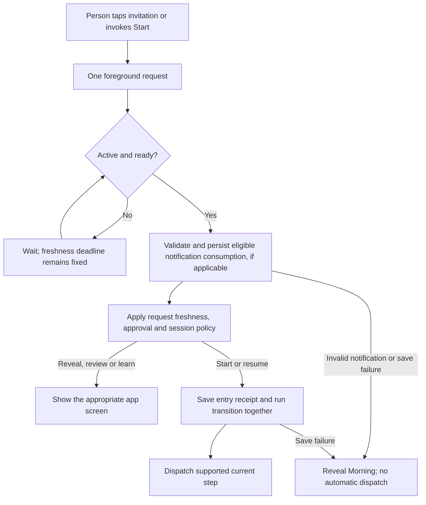

# An invitation to start your morning

**Historical invitation evidence at `6f647b4`; physical delivery and Siri validation pending.** MORE schedules one future local invitation and routes an explicit start request into an approved morning. That package suite passed **138 checks with two optional model skips**. A real local invitation was registered, delivered and tapped in the simulator; that first run exposed a callback-thread crash. Completing the delegate callback on the main actor fixed it: the targeted delivery → tap → approved start rerun passed **1/1 in 59.100s**. Five other entry checks passed before that final delegate fix, including deferral behind an open detail sheet. [PHASE-ONE](PHASE-ONE.md) preserves the separate runs and latest source. See the verification record for the latest installed build; installation does not repeat delivery or Siri validation.

## Set a one-time invitation

1. Tap the small clock beside **morning**, or open **Review → Settings → Your next morning**. The home clock shows a time only for a registered upcoming invitation; opening the editor does not schedule it.
2. Choose a future date and time, then **Set invitation**. This explicit action is the only invitation path that can request notification permission.
3. Read the resulting status. A saved time is not necessarily a registered notification: denied access or disabled alerts leaves the preference unscheduled. **Notification settings** opens the system settings.
4. When the notification appears, tap its body or **Start morning**. The app opens and starts or resumes an approved routine when ready. A draft opens review; an empty workspace opens learning.

**Cancel invitation** cancels this feature's pending/delivered notification and marks its saved record canceled. It does not erase a routine, history, thoughts or an observation. If the invitation file cannot be restored, **Reset invitation** offers recovery without resetting the workspace.

This is one occurrence, not a recurring alarm. Its chosen instant stays fixed when traveling; the original time zone is retained for display, and the native calendar trigger uses UTC components. For example, an invitation selected before a time-zone change still fires at the original absolute instant. Focus, system notification settings and device conditions can affect presentation. Registration does not prove that a notification was delivered, seen or heard. [Apple: local notification scheduling](https://developer.apple.com/documentation/usernotifications/scheduling-a-notification-locally-from-your-app), [notification permission](https://developer.apple.com/documentation/usernotifications/asking-permission-to-use-notifications).

## Siri and entry behavior

The **Start morning** App Intent requests immediate foreground execution and local-device authentication. The app advertises phrases including “Start my morning with MORE”. Discovery, actual spoken invocation and locked-device behavior still need a signed-phone check. The intent enqueues a request; it does not directly approve a routine or execute a background morning. [Apple: supported intent modes](https://developer.apple.com/documentation/appintents/appintent/supportedmodes), [local-device authentication](https://developer.apple.com/documentation/appintents/intentauthenticationpolicy/requireslocaldeviceauthentication).

The notification delegate enqueues only a response to the notification body or its configured foreground Start action. Delivery, foreground presentation and dismissal do not start a run. The action requests foreground presentation and authentication. [Apple: foreground notification actions](https://developer.apple.com/documentation/usernotifications/unnotificationactionoptions/foreground).

| State when a request is handled | Result |
|---|---|
| App inactive, a review/detail sheet open, recording/recovery/analysis busy, a save in progress, or microphone ownership unresolved | Keep the request pending until the foreground UI is ready. Existing capture review takes priority. |
| Ready within the request's 60-second lifetime; approved routine, no active run | Save the entry receipt and new session, then dispatch supported steps. |
| Ready within 60 seconds; approved routine and paused run | Save the receipt and resume the pinned run. |
| Already running | Reveal the existing morning without restarting speech or its current operation. |
| Unapproved draft or no routine | Open review or learning; do not grant approval. |
| Expired request, clock rollback, duplicate, unavailable workspace storage, or invalid invitation | Reveal the ordinary morning without automatic execution; use its manual controls when available. |

There are **two separate clocks**. A notification occurrence is eligible from its scheduled instant until two hours later. Once its tap reaches the app, the foreground request has at most **60 seconds** to begin automatically. Waiting does not renew that deadline. After a long review, it reveals Morning rather than unexpectedly starting speech. Duplicate callbacks cannot renew the same waiting request.

Starting an invitation never starts screen recording, the microphone listener or a new permission flow for capture. Recording still requires its explicit UI and Apple's system sharing choice. The invitation does not detect waking, first pickup, Alarm completion or a DeviceActivity first-use callback.

## Persistence before effects

The optional [Live Activity](LIVE-ACTIVITY.md) has a narrower entry contract: `more://morning` **reveals Morning only**. It does not create a Start request, consume an invitation, resume speech or dismiss an unfinished review. MORE pauses a running morning when it backgrounds; returning from its Lock Screen display still requires Resume. Its current native presentation checks are separate from the invitation results above.

The invitation service is a single main-actor writer. It saves desired configuration before asking the OS to schedule it. Native operations are serialized and revision checked so a late callback cannot resurrect a canceled or replaced occurrence. Reconciliation refreshes settings and repairs a still-future schedule without re-adding a due/expired invitation. It never creates permission intent from a saved preference or a passive refresh. It may finish a still-pending explicit **Set invitation** permission request for the same occurrence. That authorization to ask is transient and is not restored after relaunch.

Once the foreground app is ready to accept a notification response, it consumes a valid, still-eligible occurrence before applying the final destination. Consumption can therefore happen even when the routine is a draft or the separate 60-second foreground request has expired; those cases open review or reveal Morning without automatically starting a run. An invalid or expired notification occurrence is not consumed.

`MorningStore` saves the entry receipt and start/resume transition together in `workspace.json` before speech or another supported operation. Notification consumption is a **separate** durable write in `morning-invitation.json`. A crash between those writes can consume the invitation without starting the run; the person then uses manual Start. This is at-most-once automatic entry for that invitation, not an exactly-once transaction across files or external effects. Save failure does not dispatch an automatic step.

| Local record | Contents and lifetime |
|---|---|
| `morning-invitation.json` | One occurrence ID, scheduled instant, display time zone, expiry, disposition and optional consumption time, inside the normal JSON envelope. No routine, messages, calendar contents or speech transcript. Replacement creates a new occurrence ID; cancellation can retain canceled metadata. |
| Notification payload | Occurrence ID and payload schema version; generic title/body. A stale or mismatched occurrence cannot authorize a new start. |
| `workspace.json` | Up to 64 recent entry IDs alongside the routine/session data already saved there. The receipt is written with its run transition. |
| Pending foreground request | In-memory request and optional invitation payload. It is not a new durable job that resumes silently after process death. |

Fixture workspaces use separate local storage and the notification identifier `more.morning.invitation.ui-testing`; ordinary builds use `more.morning.invitation`. Fixture reconciliation/removal therefore targets the test invitation, not the person's ordinary one. System notification permission remains app-wide. Routing tests inject entry requests without proving Siri discovery or OS notification delivery.

## Device checks still required

Use a harmless approved synthetic routine and record the actual installed revision/device. Schedule a near-future invitation, verify the permission flow and its visible status, then observe delivery and tap it. Repeat with denied access, disabled alerts, cancellation, replacement, a terminated app and a locked phone. Check the fixed-instant behavior across a time-zone change; record unavailable/system-suppressed cases rather than calling them delivery passes.

Verify that an open detail/review sheet, active recording, analysis and a listening turn defer entry. Closing the sheet within 60 seconds may start; waiting past the deadline must require manual Start. A duplicated notification response must not repeat speech or start another run. Exercise draft and empty-workspace entry, and verify invitation reset leaves routine data intact. Test an actual spoken Siri phrase separately from these notification and injected-routing checks.

First-use/alarm triggers, recurring schedules, Home Screen widgets and spoken wake-up invitations remain separate work. The new Live Activity is a progress display, not a wake trigger. [Start opportunities #16](https://github.com/gibouu/morning-operator/issues/16), [voice commands](VOICE.md), [implementation state](PHASE-ONE.md).
