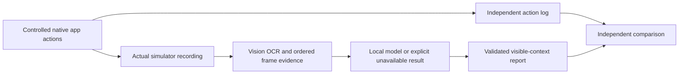

# Testing what the recording actually tells us

MORE now has a reproducible cross-app recording test. Two separate native apps contain invented messages and calendar entries. XCTest performs a known sequence; the saved movie goes through the same extraction service as a selected recording. The controller's log stays outside the model input.

**Navigation, recording, OCR and saved evidence are verified; semantic recognition remains unproven.** The first Mac attempt reported `modelNotReady` without attempting generation. A later simulator app attempt reached the real recognition action and reported model availability, but all six generation batches failed because a required backend rejected this simulator. Neither result is a model-accuracy pass. The verified layout slice, **`fb0e4a2`**, preserves optional OCR line geometry; its separate results appear below. The later dated archive and [source-linked pending proposals](ROUTINE-LEARNING.md) build on that evidence path without establishing measured habit aggregates or real multi-observation model quality. [PHASE-ONE](PHASE-ONE.md) records the current source and its separate checks. Earlier `e7666cd`/`dd611fd` checks and the initial `4ddb524` baseline remain historical results.



## Seeded digest capture — 10 October 2026

The new digest variant renders fresh synthetic message and event content, with an explicit seed for replay. The first actual run, `digest-handoff-01`, used seed **`0000000000000001`** and generator **`seeded-fixture-v1`**. The native test passed **1/1 in 81.623s**, with no skips, and the simulator movie finalized successfully. Its separate controller truth contains **20 events in total, including two verified `digestSource` records**; the source records verify specific visible fields rather than asserting a model answer. This is **one captured seed**, not three independent digest trials or five personal mornings.

Fresh `selectedMovieLayoutReport` extraction passed **1/1 in 52.698s**, retaining **24 samples and 460 OCR regions**. All **24 frames** appear in prepared input, across **11 batches**. No model receives that preparation in this run. The independent literal check finds **11/11 required field strings somewhere in retained OCR**, using whitespace folding. It is not a check of sender/date association, source attribution, comprehension or semantic recall. The controller truth was opened after extraction completed.

The next stage stays explicitly blocked: `actual-stage-status.json` records an unavailable producer and no claims because the semantic digest adapter is not implemented. The independent scorer actually ran and returned **exit 3**; `digest-score-blocked.json` has `benchmarkStatus: blocked`, null fact metrics and speech not assessed. A successfully captured movie and visible strings are not a produced, validated or spoken digest.

Artifacts remain in ignored `work/observation-benchmark/digest-handoff-01/`, including the movie, seeded content, capture metadata, truth, test result, layout report, literal coverage and blocked-stage/score reports. The [digest protocol](DIGEST-TEST-PROTOCOL.md) provides repeatable seed commands and the three-seed/physical-app/day gates; the [scorer contract](../Benchmarks/morning-digest-contract.md) defines exact facts and runtime evidence. Fourteen synthetic scorer tests pass, which establishes scoring behavior only. The earlier baseline and failed recognition attempts below remain separate historical evidence.

## The first recording

On 10 October 2026, Xcode 27 drove an iPhone 15 Pro Max simulator running iOS 27.0. The native driver passed **1/1 in 91.870 seconds**. Its 45 seconds of deliberate holds were only part of that time; app launch, accessibility verification and navigation took the rest. The finalized movie was **97.155 seconds**, including startup and teardown.

| Controller action | Independently verified effect | What the movie analysis establishes |
|---|---|---|
| Open Cedar Mail | Named heading and inbox visible | Readable inbox text appears in sampled frames |
| Issue one upward swipe | Visible row identities or positions changed | Different row content appears; exact gesture count is not inferred |
| Open a visible message | The selected synthetic detail and Back control appear | The detail's text appears in the OCR |
| Return, then open Lumen Calendar | Calendar heading and list visible | Calendar text appears in sampled frames |
| Issue one upward swipe | Calendar rows visibly changed | Changed content appears; no claim of reading or intention |
| Return to Cedar Mail | Inbox returns to the foreground | Return-screen text is retained in ordered evidence |

All **24 requested samples** decoded and yielded text. Some requests resolved to the same actual presentation time in the simulator's movie; 24 requests are not 24 distinct moments or continuous observation. OCR also picked up symbols next to headings and the system's previous-app breadcrumb. Those labels are not reliable foreground-app identity on their own.

A separate metadata inspection found 746 encoded presentation frames. All returned times matched encoded timestamps; 23 requests fell inside the selected frame's interval up to its next encoded image, and the remaining selection was 0.116 seconds later. Long-held encoded images explain this baseline's repeated sample times. They are not missed capture, extra opens or reading time. The app still treats requested time, actual presentation time and continuous-capture coverage separately.

The initial classifier's 900-character per-frame limit excluded dense list screens. Its strict catalog matching could not accept the icon-prefixed headings in the remaining fixture samples. These are recorded defects in the first analysis design, not successful recognition. The model-unavailable result cannot establish abstention quality, precision, recall or routine quality.

The separate app-import suite passed **2/2 in 112.369 seconds**:

- The actual movie produced visible notes containing both fixture headings and saved frame metadata. Both survived relaunch without reimporting. Editing removed the frame association; clearing stayed cleared after another relaunch.
- A generated four-second black movie exercised a failure path. The app showed a no-readable-text error and preserved the previous observation across relaunch. This is fault injection, not a native capture test.

At the initial `4ddb524` checkpoint, shared checks passed **163**, with **four optional model tests skipped**. An additional explicitly requested Mac movie/model run **failed its model-availability requirement after saving extraction diagnostics**. These outcomes must not be combined into an “all tests passed” claim.

## Input refinement and the simulator model attempt

Historical source checkpoint: **`e7666cd`**, with checks at **`dd611fd`**. The later copy-only change renamed “with text” to “with complete text” to match the exclusion of truncated OCR; that label was not rerun at this checkpoint. The classifier selects an exact, whole-line prefix of at most **320 characters and six nonempty lines** from each complete OCR frame. Original text, sample IDs, order and requested/actual timestamps remain unchanged. Saved selection metadata records the policy, exact source range and excerpt. A quote must occur in both that selected excerpt and the original frame; source OCR that was truncated remains ineligible.

Catalog comparison may ignore leading punctuation or symbol decorations while retaining the raw exact quote. It does not repair alphabetic `J`/`y` OCR noise or choose between competing catalog names, including previous-app breadcrumbs. Generic labels remain literal visible contexts, never verified app identities.

| Check | Result and limit |
|---|---|
| Preparation-only replay of the unchanged baseline (`preparation-v2.json`) | **24/24 frames eligible**, **2,217 selected characters**, no excluded frames. Eight frames had a deterministic catalog-line candidate. This checks input selection and citation rules only; it did not invoke a model and is not AI accuracy or eight recognized app appearances. |
| Full shared package after excerpt refinement | **170 passed, four explicitly skipped**: 77 Core and 97 Apple cases including skips. This is the latest full package run before the subsequent native-error diagnostics tests. |
| Initial app-process model UI check | Failed before inference because the recognition action could not be found through its accessibility identifier. The inherited identifier was corrected and the control moved above the sample list. |
| Corrected app-process attempt (`.build/more-recorded-model-fixed.xcresult`) | Reached real recognition with availability reported as available: **six attempted batches, zero responses, six failed batches, 24 unknown decisions**. The saved result is `failed`, not unavailable, skipped, abstention or successful classification. |
| Backend investigation | The app's own process log records `operationNotAllowed` and “Simulator is not supported” while a required model backend requests metadata. This is an environment/backend rejection in this attempt, not evidence that the synthetic content violated a content rule. |
| Sanitized error diagnostics follow-up | Added fixed native error categories and a restricted system-domain/code fallback; no localized descriptions, prompts, responses or SDK context text are persisted. The targeted suite passed **22**, with **one optional preparation-replay check skipped** (23 listed); the app build passed. At this checkpoint the full package suite had not rerun after these three new mapping tests. |
| Final diagnostic runtime check (`.build/more-recorded-model-diagnostics.xcresult`) | **Failed 1/1 in 31.936s**. Availability was again available, with six attempted/zero responded/six failed batches and 24 unknown decisions. Each saved native diagnostic contains only `{category: other}`. The unsupported-simulator cause comes from the separate own-process log, not this sanitized category. |

The local reports `simulator-classification-v2.json` and `simulator-classification-diagnostics.json` retain the failed attempts; the own-process investigation log stays local. The exact 2,217-character total belongs only to the preparation replay; separate OCR reruns produced slightly different text lengths. Availability preflight did not guarantee successful generation. No further unchanged simulator model retries are planned. A physical phone was not connected for this follow-up, and the installed `8a640ea` app was left untouched. A supported device attempt and independently scored model output are still required.

## Native OCR layout evidence — 10 October 2026

All checks in this section ran on source **`fb0e4a2`**, with no subsequent code change.

Video extraction now retains optional, bounded layout alongside each frame's original flattened OCR. Each retained region has an extraction-local UUID, exact text, exclusive Swift Character offsets, selected OCR candidate confidence, and approximate axis-aligned bounds in the oriented image's normalized **lower-left** coordinates. Bounds come from Vision's candidate-range bounding box; they are neither exact glyph outlines nor a verified title, foreground app, tap target or semantic-confidence score.

The same Vision pass produces text and geometry. Missing or invalid geometry preserves readable text with an explicit warning. At most 256 regions are retained per frame. Existing character/UTF-8 clipping keeps only whole original region spans; it never invents a smaller box for a clipped line. Older records decode with no layout. An empty retained list is not evidence of blank OCR or complete layout coverage. Original sample order, requested time, actual presentation time and unknown capture coverage retain their existing meanings.

The classifier's `whole-line-source-prefix-layout-v2` policy can include optional layout hints for exact lines inside its selected prefix. Exact source geometry stays saved; hints are rounded to six decimal places and omitted as needed to preserve the existing prompt budget. The selected line IDs are recorded. Layout does not override competing-header ambiguity or authorize foreground-app claims. Citation checks now require the actual UTF-8 source bytes, so canonically equivalent but differently encoded text cannot substitute for an exact source quote.

| Check | Result and limit |
|---|---|
| Full shared package with layout and exact-citation checks | **190 passed, six optional checks skipped**: 86 Core passes and 110 Apple cases including six skips. Both actual synthetic-image Vision checks passed in approximately 28.3 seconds each. Includes native text/bounds, legacy decoding, exact spans, character/UTF-8 clipping, line caps and conservative hint preparation. |
| Native app build | Passed. No physical-phone installation or model inference was performed for this slice. |
| Complete saved-movie layout extraction | **1/1 passed in 83.642s**; `baseline-01/layout-01.json` retains 24/24 observed samples, 647 native OCR regions and zero frame warnings. Preparation retained all 24 frames and 140 layout hints across 12 batches. No model was called. |
| Recorded-movie app regression | `.build/more-ocr-layout-import.xcresult`: the actual-movie import/relaunch/edit/clear journey **passed in 71.113s**. The separate blank-video case **skipped in 0.05s** because its opt-in was missing; this run is one pass and one skip, not 2/2 passes. |
| Correctly opted-in blank-video regression | `.build/more-ocr-layout-blank.xcresult`: **1/1 passed in 39.404s, no skips**. The blank-video error preserved the previous observation through relaunch. This is the separate corrected rerun of the fault-injection case, not another capture result. |

The local `layout-analysis-01.json` inspection locates a smaller previous-app breadcrumb near normalized y=0.950 and a larger fixture heading near y=0.883–0.885. This is useful retained geometry; both names can still be present, and neither the validator nor this inspection claims a foreground-app identity score. These results establish the implemented evidence structure and the named checks, not heading-attribution accuracy, model accuracy, app-use duration or a learned habit.

## Repeat the controlled capture

Use a booted, dedicated simulator with synthetic data. Obtain its UUID from `xcrun simctl list devices`; set `MORE_SIMULATOR_ID` to that UUID. The helper refuses a nonbooted or unavailable iOS simulator. It installs only the two benchmark apps, records their displayed output and runs the separate benchmark test target. No fixture is a dependency of the production app scheme.

```sh
./scripts/generate-project.sh
xcodebuild build-for-testing \
  -project MorningOperator.xcodeproj \
  -scheme MorningObservationBenchmark \
  -destination "platform=iOS Simulator,id=$MORE_SIMULATOR_ID" \
  -derivedDataPath .build/benchmark CODE_SIGNING_ALLOWED=NO

python3 scripts/run-observation-benchmark.py \
  --device "$MORE_SIMULATOR_ID" --variant baseline --run baseline-01
```

Choose a fresh run name. Output goes to ignored `work/observation-benchmark/<run>/`: the real movie, recording-start/finalization bounds, Xcode log and result bundle. The JSONL attachment separates issued gestures, observed row movement, detail visibility, foreground observations and endpoint-only holds. Export it with Xcode's result tools for scoring. The script stops its own recorder with SIGINT and waits for movie finalization.

`--variant heldout` reverses the app order. It is a driver option, not a completed held-out accuracy result. The fixture vocabulary contains no expected order, action count or duration. The optional movie integration check takes absolute local paths:

```sh
MO_OBSERVATION_VIDEO_PATH="$PWD/work/observation-benchmark/baseline-01/recording.mov" \
MO_OBSERVATION_REPORT_PATH="$PWD/work/observation-benchmark/baseline-01/model-report-next.json" \
MO_OBSERVATION_FIXTURE_CATALOG=1 \
MO_OBSERVATION_ORIGIN=synthetic \
MO_OBSERVATION_MAX_SAMPLE_GAP_SECONDS=5 \
./scripts/test.sh --with-model --filter selectedMovieInferenceAndReport
```

Use a fresh report filename to preserve earlier attempts. The test saves original frame evidence, classifier status and decisions, trace and derived report before checking model availability. Omit the catalog flag to exercise ordinary generic visible-context recognition. The ordinary app does not supply the benchmark catalog. Neither mode receives the controller log. Capture coverage remains unknown in this artifact unless independently established; file duration alone does not fill it in.

To inspect preparation and deterministic citation possibilities without another OCR or model call:

```sh
MO_OBSERVATION_REPLAY_PATH="$PWD/work/observation-benchmark/baseline-01/model-report.json" \
MO_OBSERVATION_REPLAY_REPORT_PATH="$PWD/work/observation-benchmark/baseline-01/preparation-next.json" \
./scripts/test.sh --filter replaySavedEvidencePreparation
```

This replay refuses to overwrite an existing output. Its catalog candidates are validation possibilities, not model predictions or foreground-app detections.

To re-extract the complete saved movie with native line geometry and inspect prepared input **without invoking a model**:

```sh
MO_LAYOUT_VIDEO_PATH="$PWD/work/observation-benchmark/baseline-01/recording.mov" \
MO_LAYOUT_REPORT_PATH="$PWD/work/observation-benchmark/baseline-01/layout-next.json" \
./scripts/test.sh --filter selectedMovieLayoutReport
```

Both paths must be absolute and the output must be new. The check refuses to replace an existing report or the source movie. It saves source text, exact optional geometry and prepared-prefix metadata locally with owner-only file permissions; it receives no controller truth, catalog or expected sequence. This is a fresh Vision extraction, so OCR can differ from an earlier pass. It does not make a model call or an accuracy judgment.

## What still needs to pass

1. Validate current-heading attribution on icon noise, competing breadcrumbs and body mentions. Bounded input eligibility is now tested; robust visual-context recognition is not.
2. Run the real local model in a supported, ready environment on both baseline and previously unscored recordings. Compare validated labels, unknowns, false positives and misses against separately aligned truth. Count only equivalent metrics; sparse visual appearances are not OS launch counts.
3. Add rapid transitions, static screens, unsuccessful gestures, ambiguous headers, blank frames and setup-only observations. Preserve each failure rather than changing the scoring definition afterward.
4. Record four or five independent comparable synthetic sessions before testing multi-day denominators. Duplicating this movie under different dates is not several mornings.
5. Repeat the native phone capture path with the owner's system approval. Simulator recording is not ScreenCaptureKit consent, background behavior, protected-app support or personal habit accuracy.

Raw movies, OCR, action logs, workspace data and screenshots stay local and ignored. Only synthetic source and reviewed aggregate results are shared. See [observation metrics](OBSERVATION-METRICS.md), [retention](ARCHITECTURE.md#data-retention-today) and [benchmark issue #23](https://github.com/gibouu/morning-operator/issues/23).
