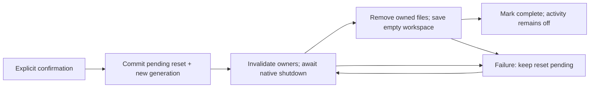

# Your local data

**16 October intelligence update:** Apple remains the default model. Settings → Intelligence & memory can explicitly enable OpenAI for selected learning text/OCR/browser evidence, transcribed owner requests, saved personal facts, mail drafting and relevant connected-service results. This route uploads no raw audio or video and does not collect authentication fields from the browser. Selected observation text can itself contain private information. Current weather text may be used for one contextual suggestion; coordinates are not added to that request. Sleep and other Health-measurement segments from Apple's briefing remain excluded from the general OpenAI conversation context. User-supplied observation text may itself contain private information; review selected sources before analysis. Requests use `store: false`, which disables API response storage but is not a promise of zero provider retention. [OpenAI data controls](https://developers.openai.com/api/docs/guides/your-data).

The personal development key is entered by its owner and kept in this installation's Keychain with `WhenUnlockedThisDeviceOnly`; it is never compiled into the app. A distributed customer product needs a server-held credential and per-user access/billing before release. Disabling OpenAI stops remote inference and retains the disabled key; **Remove OpenAI key** deletes it. Full local forgetting deletes the key and personal-memory file, cancels model requests and rejects late results. It cannot erase a request already processed by OpenAI. No automatic remote fallback exists.

Personal memory retains up to 24 recent, explicit facts/preferences, not an audio transcript. New corrections replace the matching stable fact. The memory is local at `personal-memory.json`; when OpenAI is enabled it becomes bounded context in model requests. Final microphone transcripts from a separately consented ElevenLabs conversation use this same selected extraction route, including outside a morning. Saved memory is not added to Gemini's context; app-prepared answers may use relevant facts in the text explicitly narrated during that conversation. Settings allows individual deletion. The model cannot learn a personal fact from mail/page/service content, app narration or agent responses. Original observations, routine choices and personal memory are separate stores.

**15 October connection update:** API authorizations and tool requests/results pass through the configured connection service and Composio. Returned data stays transient on the phone; adding an API action to a routine saves its exact parameters in the routine and any retained run snapshot. The server keeps content-free request fingerprints and receipt metadata, not provider results. The installation token and unresolved local execution hashes/UUIDs use scoped Keychain items; named shortcut settings are workspace-scoped. Full local forgetting clears those local items and invalidates late callbacks. It does not revoke remote Composio/provider grants or erase server metadata; use Connections → API → Disconnect for a revocation request, or manage access at the provider. [Connection scope](CONNECTIONS.md).

Full local forgetting first shipped in source `640370c`; source `f783658` also removes briefing settings and transient day recaps. The cancel/preserve/forget/relaunch journey and isolated workspace inspection passed again with a synthetic briefing payload. Earlier privacy tests retain their dated results in [PHASE-ONE](PHASE-ONE.md). This does not establish physical recording shutdown or deletion from external Apple apps.

## Current location and access preparation

After the paywall, MORE offers one optional voice explanation for speech recognition and microphone together. One action prepares the necessary iPhone permissions in sequence, without starting listening; declining or skipping continues directly into the app. Already granted voice access does not repeat this step. Calendar, reminders, Screen Time, notifications and alarms are requested when the person chooses the relevant feature, or individually from the access overview in Settings. Existing location/weather choices are preserved; location remains available from the explained weather controls. Returning to permissions in Settings does not start listening, recording, an alarm or a routine. System permissions remain controlled by iOS.

With current-location weather enabled, one-shot foreground location requests supply coordinates to Apple Weather and the local solar calculation. Device coordinates and current weather remain in memory, are invalidated on privacy cleanup and are not added to routine/observation history. A deliberately selected fallback city is a saved preference. WeatherKit and Apple Maps retain their own service processing; the app does not add device coordinates to model requests; an explicitly enabled OpenAI route may receive current weather text.

## Use the Privacy screen

Open **Review → Settings & connections → Privacy & data**. The inventory shows the current and previous routine, saved mornings, observations, thoughts and saved choices. It also explains less visible copies: quoted evidence inside routines, pending suggestions, recording recovery, app activity, invitation settings, selected calendar identifiers, chosen weather city/unit and local Apple-app save receipts. If saved data cannot be read, the screen says so instead of presenting zero as a known count.

**Save app activity from Shortcuts** controls whether configured transition actions can write new app names and entry/exit times. Turning it off keeps existing history. It does not delete or disable the automations in Shortcuts, and it does not control screen recording. After full forgetting it stays off until you explicitly enable it again.

Choose **Forget MORE’s local data**, read the scope, then confirm **Forget local data**. Canceling the confirmation does not start removal. This action removes MORE's current routine and previous version, saved runs and their pinned routine content, thoughts, observations, corrections, derived interpretations, pending suggestions, saved choices and their retained snapshots, activity journal, invitation metadata/notifications, briefing settings, local receipts and owned recording copies. It also clears temporary app state and resets the selected speech voice. There is no undo or retained previous routine after a successful full forget.

The app stops its work before claiming completion. A screen recorder that may still be active, an unresolved microphone release or a file that could not be removed leaves cleanup pending. The screen reports **Removal needs another try** and keeps ordinary work blocked. Retry from Privacy; relaunch automatically resumes an already-requested removal before loading old content. An unreadable privacy-control record blocks ordinary access and requires an explicit removal request to recover.

## Where the copies live

**Spoken saved moments:** selecting an observation excerpt stores its quote, dated sentence and local source reference inside a routine. Earlier versions, saved runs and explicitly kept steps can retain these copies. Deleting the observation blocks source-backed playback but does not erase copies inside those other categories; full forgetting does. Portable files omit source references, while an export with notes includes the sentence. [Saved-moment lifecycle](SAVED-MOMENTS.md).

**Screen reviews:** a label or unknown choice, frame ID, selected exact excerpt and review time live inside the corresponding observation. They are separate from original OCR and model output. Removing the review restores the retained interpretation; changing the observation's notes clears its screen reviews. Deleting the observation or full forgetting removes these records and invalidates dependent pending suggestions. Already approved routine quotations/history remain separate copies. Screen reviews add no raw media, upload or model-training store.

The normal local data directory is the app's **Application Support/MorningOperator** directory inside its own container. Development overrides and isolated UI-test workspaces have their own locations; they must never be treated as the person's production workspace.

| Copy | Location / ownership | Full forget |
|---|---|---|
| Routines, previous version, session, run history, observations/original OCR/corrections/screen reviews/layout/classification, suggestions, choice snapshots, thoughts, settings and local effect/entry receipts | `workspace.json` | Replaced by an explicit empty workspace; no retained routine or evidence recovery slot. |
| Invitation ID, chosen time/zone, expiry and consumption/cancellation metadata | `morning-invitation.json`; MORE's pending/delivered notification request | Cleared and removed; notification authorization remains unchanged. |
| Optional Lock Screen progress | Opt-in in `workspace.json`; ActivityKit owns the generic category/status/count display and opaque IDs | Opt-in resets off; new publication is blocked and native immediate dismissal is awaited before reset completion. No step names, notes, source quotations, calendar facts or transcripts enter this payload. The native ActivityKit cleanup and off-after-relaunch journey passed in the dedicated simulator. Physical-device cleanup remains unverified. |
| Selected calendar IDs, weather city name/coordinates, temperature unit and the health on/off choice | `briefing-settings.json` | Removed, so health is excluded again; no event titles, sleep samples or prepared recap text are persisted here. |
| Configured app entry/exit records | `app-transitions.json` | Removed; future collection disabled locally. |
| Failed/pending app-created recording and its coverage/start metadata | `RecordingRecovery/pending-screen-recording.mp4`, `RecordingRecovery/recording-info.json` | Removed after the native recording owner has stopped. The recovery directory is excluded from backup. |
| Active or orphaned app-created movie | App temporary `MorningOperatorRecordings/morning-<UUID>.mp4` namespace | Stop/finalize or discard, then remove only recognized owned files. Isolated UI tests use their own workspace recording namespace. |
| Interrupted workspace JSON staging files | Reserved `.morning-save-*` sibling files | Removed because they can contain an old complete workspace. Unexpected directories or unsafe paths are reported rather than recursively swept. |
| A confirmed selective removal that has not finished | `evidence-removal.json` | Removed. It holds observation identifiers, the confirmed instant and a digest of the plan, never observation words. |
| Personal facts/preferences and OpenAI key | `personal-memory.json` and installation Keychain | Removed; in-flight model replies cannot restore them. |
| Privacy state and serialization lock | `local-data-control.json`, `.morning-privacy-lock` | Retained intentionally. These hold no routine, transcript or evidence: only an opaque generation, pending flag and activity setting; the lock coordinates cooperating writers. |
| Transient dictation, capture/import review, router requests, calendar/weather snapshots, sleep samples/duration/window/source kinds, prepared recap and speech state | App memory | Invalidated/cleared; late results cannot attach to the new generation. |

Deleting just one observation has a narrower scope: it removes that acquisition and invalidates dependent pending suggestions, but it does not erase quotations already retained in a routine, archived run or Keep choice. **Forget this observation…** on the same screen first lists every copy of it (see [Expiry and forgetting one observation](#expiry-and-forgetting-one-observation)). Full forgetting removes those app-owned copies too. Export is separate from deletion; see [routine files](ROUTINE-FILES.md).

## Optional Apple services and surfaces

**Morning at a glance** is a separate, off-by-default display choice. Its generic categories and counts are visible to anyone who can see the Lock Screen or another system-selected presentation. MORE's widget extension does not read the workspace or contact a server, and it has no microphone. It adds no push token or APNs service. Turning it off ends the display without deleting a routine; full forgetting additionally resets its saved preference. [Live Activity scope](LIVE-ACTIVITY.md).

**Apple Health** is an explicit, off-by-default choice in **Settings → Health**. The read-only connection requests sleep, resting heart rate, heart rate variability (SDNN) and breathing rate; a pre-existing sleep-only choice needs a separate explicit upgrade for the extra measures. It writes nothing to Apple Health. Samples, duration/window, source names, measurements and prepared sentences remain in memory; only inclusion/scope choices are saved. They are not observation evidence or training records. Health segments are excluded from the optional OpenAI conversation context; activating that general model does not grant Health sharing. The default voice route stays on-device. A separately explained and explicitly started [online conversation](NATURAL-VOICE.md) can transmit the text MORE pronounces to ElevenLabs and Google Gemini for that session; Apple Health permission alone never enables this.

Disabling Health cancels reads and voice work, stops any online conversation and withdraws transient/pinned Health playback. Full forgetting removes the saved choices and invalidates pending work. Leaving the app invalidates Health playback admission, requiring a fresh reading on return. No Health data reaches the widget. An empty result can mean no recorded/synced data or withheld reading access; MORE cannot distinguish these. Turning the choice off or forgetting MORE data neither deletes Apple’s records nor revokes the system grant; manage that grant in Apple Health or iOS Settings. Live-device results remain separate from fixture tests. [Health in Your day](YOUR-DAY.md#sleep-duration).

**Your day** sends an explicit city search to Apple Maps and the chosen city's coordinates to Apple Weather. It does not request device location. EventKit reading remains a local store read. Weather responses, event titles and prepared sentences remain transient and are not observation evidence or training records. These requests contain no recording, OCR or habit content. The app has no automatic remote-model fallback; the explicit OpenAI route is described above. [Your day guide](YOUR-DAY.md).

Browser execution records retain only bounded SHA-256 content fingerprints alongside the session's observed-content count, not the source page text, URLs or DOM. These local identities prevent the same content being counted again after a process restart. They share the workspace's retention and full-forgetting behavior; they are not a history of raw browsing content or a provider-effect receipt.

## What stays outside MORE

- Original media selected from Photos, Files or another provider, and routine files imported from those locations.
- Files you explicitly exported, including any provider or backup copies of them.
- Events and reminders already saved in Apple's apps, including uncertain outcomes that must be checked there. Forgetting local receipts does not delete, retry or reverse those items.
- System permissions, installed Apple voices, Shortcuts definitions and their separately managed history, and device/account backups.
- Developer recordings, screenshots, logs and Xcode result bundles under ignored `work/` or `.build/` locations. Clean them deliberately on the development Mac; app controls cannot remove them.

This is logical removal of app-controlled copies, not secure erasure or a promise to remove filesystem snapshots, backups, provider caches or OS-managed records. Most workspace data is not explicitly excluded from device backups. The optional connection backend is separate from local forgetting; no telemetry upload, automatic model-training dataset or research-contribution pipeline is implemented.

## Reset ordering and late work

`LocalDataControl` uses a shared file lock around cooperating read/mutate/save operations. The pending marker closes ordinary access before deletion begins. Asynchronous analysis, capture and entry work checks its ownership/generation before attaching a result; background transition logging checks collection permission inside the same lock as its journal save. Invitation forgetting invalidates its permission/reconciliation revision, drains a late native add, and checks that its pending and delivered requests are absent. Live Activity cleanup blocks new publication, drains earlier activity work and awaits immediate removal; its coordinator is released for future work only after the privacy generation finishes successfully. Test activities are scoped to their isolated workspace, not the person's ordinary activity.

The controller then removes an explicit set of owned payloads, saves an empty workspace, clears memory, and marks that generation complete. A failure before the pending marker commits starts no payload removal. After it commits, cleanup may be partial: the app preserves the pending marker and never restores the old workspace as a rollback. Startup reads this control before old workspace/recovery data and resumes pending removal. The marker and lock must not be deleted as part of the sweep.

File replacement is atomic at its rename boundary, with owner-only staging permissions. It does not synchronize the containing directory or promise sudden-power-loss durability. Native notification removal and multiple files are not one filesystem transaction; the pending marker makes incomplete cleanup explicit and retryable.

## Expiry and forgetting one observation

Normal recording processing removes the app-owned raw movie after extracted evidence is successfully saved; failed processing keeps a recoverable copy until Retry or Discard. That lifecycle is unchanged. An archived observation is text in `workspace.json`: there is no per-observation media file.

**Keep raw evidence for** in Privacy is Off by default: nothing expires. The choices are 30 days, 90 days and 1 year, counted from the import date. The shortest choice still covers a month of mornings, since a learning window can hold up to 31 mornings; a week would list evidence that is still being learned from. Choosing an age removes nothing. Privacy shows how many observations are older, and **Review before removing…** opens the plan: the observations that go, the quotations removed with them, the links and pending suggestion set aside, and every copy kept separately with the reason it stays. An observation with no saved import date is listed as such and never removed by age. Cancel changes nothing.

**Forget this observation…** on an observation's detail shows the same plan for that one observation.

What a confirmed removal changes, and nothing else:

| Copy | Result |
|---|---|
| The observation: original text, corrections, sampled screens, screen labels, interpretation | Removed |
| A quotation still exactly as saved, in a draft never approved or kept | The words and the link go; the step's name, category, time and place stay |
| A reworked step that still links to the observation | The link goes; the wording is the person's and stays |
| The pending suggestion built from the observation, or prepared from a draft that changes | Set aside |
| A quotation in a routine the person approved, a Keep choice, a required step, a saved morning, words with no link, or any quotation while saved choices cannot be read | Kept and listed |

The plan is worked out again from the current data when the person confirms. If it differs from the one shown, nothing is removed and the new plan is shown instead. A running analysis is waited for first. A durable marker is written before any change; the workspace is then saved without the observations in one atomic write; only after that are leftover `.morning-save-*` staging files removed, and the marker goes last. If the app stops part way, the next launch finishes the cleanup, applies the plan only if the data and the plan are unchanged from the confirmed instant, and otherwise removes nothing more and asks for a new review. Observations from segmented recording sessions are not removed here yet ([#88](https://github.com/gibouu/morning-operator/issues/88)); nothing creates them today. Export and the reduction goal in [issue #8](https://github.com/gibouu/morning-operator/issues/8) remain open.
