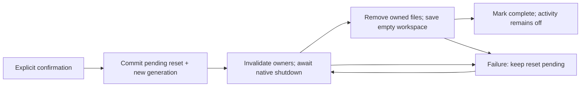

# Your local data

Full local forgetting first shipped in source `640370c`; source `f783658` also removes briefing settings and transient day recaps. The cancel/preserve/forget/relaunch journey and isolated workspace inspection passed again with a synthetic briefing payload. Earlier privacy tests retain their dated results in [PHASE-ONE](PHASE-ONE.md). This does not establish physical recording shutdown or deletion from external Apple apps.

## Use the Privacy screen

Open **Review → Settings & connections → Privacy & data**. The inventory shows the current and previous routine, saved mornings, observations, thoughts and saved choices. It also explains less visible copies: quoted evidence inside routines, pending suggestions, recording recovery, app activity, invitation settings, selected calendar identifiers, chosen weather city/unit and local Apple-app save receipts. If saved data cannot be read, the screen says so instead of presenting zero as a known count.

**Save app activity from Shortcuts** controls whether configured transition actions can write new app names and entry/exit times. Turning it off keeps existing history. It does not delete or disable the automations in Shortcuts, and it does not control screen recording. After full forgetting it stays off until you explicitly enable it again.

Choose **Forget MORE’s local data**, read the scope, then confirm **Forget local data**. Canceling the confirmation does not start removal. This action removes MORE's current routine and previous version, saved runs and their pinned routine content, thoughts, observations, corrections, derived interpretations, pending suggestions, saved choices and their retained snapshots, activity journal, invitation metadata/notifications, briefing settings, local receipts and owned recording copies. It also clears temporary app state and resets the selected speech voice. There is no undo or retained previous routine after a successful full forget.

The app stops its work before claiming completion. A screen recorder that may still be active, an unresolved microphone release or a file that could not be removed leaves cleanup pending. The screen reports **Removal needs another try** and keeps ordinary work blocked. Retry from Privacy; relaunch automatically resumes an already-requested removal before loading old content. An unreadable privacy-control record blocks ordinary access and requires an explicit removal request to recover.

## Where the copies live

**Spoken saved moments:** selecting an observation excerpt stores its quote, dated sentence and local source reference inside a routine. Earlier versions, saved runs and explicitly kept steps can retain these copies. Deleting the observation blocks source-backed playback but does not erase copies inside those other categories; full forgetting does. Portable files omit source references, while an export with notes includes the sentence. [Saved-moment lifecycle](SAVED-MOMENTS.md).

**Screen reviews:** a label or unknown choice, frame ID, selected exact excerpt and review time live inside the corresponding observation. They are separate from original OCR and model output. Removing the review restores the retained interpretation; changing the observation's notes clears its screen reviews. Deleting the observation or full forgetting removes these records and invalidates dependent pending suggestions. Already approved routine quotations/history remain separate copies. Screen reviews add no raw media, upload or model-training store.

The normal local data directory is the app's **Application Support/MorningOperator** directory inside its own container. Development overrides and isolated UI-test workspaces have their own locations; they must never be treated as the person's production workspace.

| Copy | Location / ownership | Full forget |
|---|---|---|
| Routines, previous version, session, run history, observations/original OCR/corrections/screen reviews/layout/classification, suggestions, choice snapshots, thoughts, settings and local effect/entry receipts | `workspace.json` | Replaced by an explicit empty workspace; no retained routine or evidence recovery slot. |
| Invitation ID, chosen time/zone, expiry and consumption/cancellation metadata | `morning-invitation.json`; MORE's pending/delivered notification request | Cleared and removed; notification authorization remains unchanged. |
| Optional Lock Screen progress | Opt-in in `workspace.json`; ActivityKit owns the generic category/status/count display and opaque IDs | Opt-in resets off; new publication is blocked and native immediate dismissal is awaited before reset completion. No step names, notes, source quotations, calendar facts or transcripts enter this payload. The native ActivityKit cleanup and off-after-relaunch journey passed in the dedicated simulator. Physical-device cleanup remains unverified. |
| Selected calendar IDs, weather city name/coordinates, temperature unit and the health on/off choice | `briefing-settings.json` | Removed, so health is excluded again; no event titles, sleep samples or prepared recap text are persisted here. |
| Configured app entry/exit records | `app-transitions.json` | Removed; future collection disabled locally. |
| Failed/pending app-created recording and its coverage/start metadata | `RecordingRecovery/pending-screen-recording.mp4`, `RecordingRecovery/recording-info.json` | Removed after the native recording owner has stopped. The recovery directory is excluded from backup. |
| Active or orphaned app-created movie | App temporary `MorningOperatorRecordings/morning-<UUID>.mp4` namespace | Stop/finalize or discard, then remove only recognized owned files. Isolated UI tests use their own workspace recording namespace. |
| Interrupted workspace JSON staging files | Reserved `.morning-save-*` sibling files | Removed because they can contain an old complete workspace. Unexpected directories or unsafe paths are reported rather than recursively swept. |
| Privacy state and serialization lock | `local-data-control.json`, `.morning-privacy-lock` | Retained intentionally. These hold no routine, transcript or evidence: only an opaque generation, pending flag and activity setting; the lock coordinates cooperating writers. |
| Transient dictation, capture/import review, router requests, calendar/weather snapshots, prepared recap and speech state | App memory | Invalidated/cleared; late results cannot attach to the new generation. |

Deleting just one observation has a narrower scope: it removes that acquisition and invalidates dependent pending suggestions, but it does not erase quotations already retained in a routine, archived run or Keep choice. Full forgetting removes those app-owned copies too. Export is separate from deletion; see [routine files](ROUTINE-FILES.md).

## Optional Apple services and surfaces

**Morning at a glance** is a separate, off-by-default display choice. Its generic categories and counts are visible to anyone who can see the Lock Screen or another system-selected presentation. MORE's widget extension does not read the workspace or contact a server, and it has no microphone. It adds no push token or APNs service. Turning it off ends the display without deleting a routine; full forgetting additionally resets its saved preference. [Live Activity scope](LIVE-ACTIVITY.md).

**Sleep duration** is not read by the app today: there is no HealthKit entitlement, usage description or screen, and the app does not link the module that imports HealthKit. The tested logic keeps sleep samples and the prepared sentence in memory only; full forgetting clears them and removes the saved on/off choice. [Sleep in Your day](YOUR-DAY.md#sleep-duration-logic-only-not-connected).

**Your day** sends an explicit city search to Apple Maps and the chosen city's coordinates to Apple Weather. It does not request device location. EventKit reading remains a local store read. Weather responses, event titles and prepared sentences remain transient and are not observation evidence or training records. These requests contain no recording, OCR or habit content. The app still has no remote-model fallback. [Your day guide](YOUR-DAY.md).

## What stays outside MORE

- Original media selected from Photos, Files or another provider, and routine files imported from those locations.
- Files you explicitly exported, including any provider or backup copies of them.
- Events and reminders already saved in Apple's apps, including uncertain outcomes that must be checked there. Forgetting local receipts does not delete, retry or reverse those items.
- System permissions, installed Apple voices, Shortcuts definitions and their separately managed history, and device/account backups.
- Developer recordings, screenshots, logs and Xcode result bundles under ignored `work/` or `.build/` locations. Clean them deliberately on the development Mac; app controls cannot remove them.

This is logical removal of app-controlled copies, not secure erasure or a promise to remove filesystem snapshots, backups, provider caches or OS-managed records. Most workspace data is not explicitly excluded from device backups. No backend, telemetry upload, automatic model-training dataset or research-contribution pipeline is implemented.

## Reset ordering and late work

`LocalDataControl` uses a shared file lock around cooperating read/mutate/save operations. The pending marker closes ordinary access before deletion begins. Asynchronous analysis, capture and entry work checks its ownership/generation before attaching a result; background transition logging checks collection permission inside the same lock as its journal save. Invitation forgetting invalidates its permission/reconciliation revision, drains a late native add, and checks that its pending and delivered requests are absent. Live Activity cleanup blocks new publication, drains earlier activity work and awaits immediate removal; its coordinator is released for future work only after the privacy generation finishes successfully. Test activities are scoped to their isolated workspace, not the person's ordinary activity.

The controller then removes an explicit set of owned payloads, saves an empty workspace, clears memory, and marks that generation complete. A failure before the pending marker commits starts no payload removal. After it commits, cleanup may be partial: the app preserves the pending marker and never restores the old workspace as a rollback. Startup reads this control before old workspace/recovery data and resumes pending removal. The marker and lock must not be deleted as part of the sweep.

File replacement is atomic at its rename boundary, with owner-only staging permissions. It does not synchronize the containing directory or promise sudden-power-loss durability. Native notification removal and multiple files are not one filesystem transaction; the pending marker makes incomplete cleanup explicit and retryable.

## Expiry is separate work

Normal recording processing removes the app-owned raw movie after extracted evidence is successfully saved; failed processing keeps a recoverable copy until Retry or Discard. That is a save-dependent lifecycle, **not a time-to-live policy**. Automatic age-based expiry of raw recovery files, evidence, saved thoughts and history remains unimplemented. Full forgetting is an explicit action and does not complete every selective-delete or expiry criterion in [issue #8](https://github.com/gibouu/morning-operator/issues/8).
