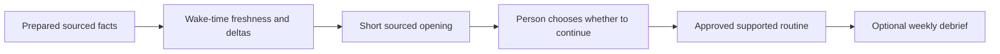

# Product direction: a short, useful morning

## 10 October 2026 — goal addendum

The founder is considering **LEVE**, evoking French *se lever* (getting up). It is not the exact French translation of “wake up.” This is a naming direction, not a completed rename or a decision about accents, pronunciation, bundle identifiers or visual identity. Name availability, trademark/domain checks and comparative ranking are unverified. The current product remains MORE in source and on screen until a separate naming change is chosen.

A preliminary Apple App Store search already surfaces [Lévé, a fitness app](https://apps.apple.com/id/app/l%C3%A9v%C3%A9/id6755659792?l=id), and [Lève!, a French wake-up alarm app](https://apps.apple.com/fr/app/l%C3%A8ve/id6807948600). These are concrete naming and search-discovery collisions, especially in the morning category; they are not a trademark-clearance finding or a measured search-ranking result. Keep LEVE as a candidate pending a broader naming check.

The intended experience is a brief spoken welcome, an invitation to hear more, and a learned morning that the person can guide naturally. Morning remains a calm single page; Review owns source evidence, corrections, permissions, settings and longer explanations. A recording teaches a proposed routine. It does not itself authorize later actions.

### Set it up, then get on with the morning

The product objective is **connect and configure once, then rarely need to open the app to manage it**. The person should spend their morning hearing useful information, moving around and enjoying chosen rituals. MORE should require attention for a meaningful choice, an uncertain interpretation or an action that genuinely needs review—not daily setup. The native app remains the place to inspect sources, change the plan and recover a problem.

This is the target experience, not a claim of unattended execution today. Saved settings can avoid repeated configuration; they cannot suppress an OS consent sheet, restore revoked access or silently authorize recording. Current runs pause when MORE leaves the foreground. General control of other apps, open conversation, continuous listening and independent HomePod operation remain separate work. An alarm/Shortcut or notification can offer an entry opportunity; neither reveals every Clock alarm nor grants screen-capture consent.

| Stage | Intended experience | Required boundary |
|---|---|---|
| Set up | Choose sources, voice/output, an approximate morning window and what MORE may prepare or do. Goals are optional. | Explain each connection when needed; preserve settings and provide clear revocation. Avoid a wall of unrelated permission prompts. |
| Learn for three or seven mornings | Offer a quick three-morning starting point or a fuller seven-morning learning period. Start observation through the supported explicit control, then let the person follow their actual morning. | These are onboarding hypotheses, not a proven accuracy threshold. Missing mornings do not count as zero; weekdays, time zones and human versus automated behavior stay distinguishable. |
| Review once | Present a short typical-morning proposal with inspectable sources and uncertain parts. The person adjusts order, enjoyment and planned time, then approves it. | Capture alone never authorizes execution. Required rituals and explicit exclusions/durations outrank a new suggestion. |
| Use it | Enter through an authorized supported start, hear the short opening, choose whether to hear more, and use brief voice controls while following the approved plan. | Useful preparation must not become an unsolicited long readout. External effects keep their scoped approvals; pause/stop and a touch fallback remain available. |
| Refine occasionally | Offer an optional weekly debrief or a meaningful proposed change. Keep the current plan until the person accepts the update. | No mandatory weekly visit, streak or constant prompt. Repeated automated playback is not evidence that the person independently chose the same habit. |

The existing learning flow selects **one to five dated observations** for a source-linked pending proposal. It does not yet collect a three/seven-morning program, derive comparable habit averages, or adapt continuously. A seven-morning onboarding option needs an explicit evidence-selection/aggregation design; it must not silently drop two days to fit today's selection limit. [Current learning contract](ROUTINE-LEARNING.md) · [Observation evidence](OBSERVATION-PLAN.md).

**Investigate a faster historical starting point.** Apple's direct Screen Time activity-data API can provide authorized aggregates outside the ordinary report extension, with the App and Website Usage entitlement and `.approvedWithDataAccess`. Development testing requires Apple's provisioning; customer availability has EU device/account conditions, and only one app can hold this data authorization at a time. This is a concrete bootstrap spike, not a claim that this app currently has the entitlement or reads that data. Query the actual historical coverage before offering “three/seven days learned.” [Direct activity data](https://developer.apple.com/documentation/deviceactivity/deviceactivitydata/activitydata%28filteredby%3Ausing%3A%29) · [Authorization conditions](https://developer.apple.com/documentation/familycontrols/authorizationstatus/approvedwithdataaccess) · [Bootstrap #30](https://github.com/gibouu/morning-operator/issues/30).

Use returned app duration, direct-to-app pickups, notification counts, first-use information and freshness only with their actual date, zone, device and coverage. These aggregates can suggest activities worth asking about; they cannot reconstruct ordered app switches, taps, reels, read intent or inbox counts. Combine them with explicitly shared observations and corrections where needed, then ask the person to review the proposed sequence. The existing report-extension sandbox is not a workaround for the direct API's authorization requirements.

Success means fewer unnecessary screen interactions, trustworthy useful facts and a morning the person prefers. The earlier aspiration of turning a two-hour phone routine into 20–30 minutes is a personal target to test, not a promised result or a norm everyone should adopt. Preserve social browsing, chess, music and other chosen pleasures. There is **no mandatory meditation** or prescribed definition of a productive morning.

### Optional goals and a useful weekly debrief

An optional goal names the person's desired change, the activity it applies to, a chosen period and what counts as progress. Examples include leaving more room for breakfast, keeping ten minutes of chess, checking email once before leaving, or gradually reducing a selected social session. The person can change, pause or remove a goal. Default mornings need no goal and no wellbeing score.

A debrief should answer three questions briefly: what was observed on comparable days, what the person liked or wanted to change, and whether one small plan adjustment would help. Let them hear it, inspect it in Review, defer it or turn it off. A plan adjustment remains a proposal. Distinguish a duration target from measured activity, self-report from device evidence, and running MORE from using another app. Report the included dates and coverage; sparse screen samples cannot establish exact scrolling, reels, message reads or total phone time.

Wellbeing can mean a self-described calmer or more enjoyable morning. Optional future HealthKit facts must retain source, period and missing-data meaning. Do not turn them into a diagnostic health score, treatment recommendation or promised improvement in sleep or mental health. [Goals and enjoyment #10](https://github.com/gibouu/morning-operator/issues/10) · [HealthKit #15](https://github.com/gibouu/morning-operator/issues/15) · [Observed metrics](OBSERVATION-METRICS.md).

### Prepare before the person asks; refresh what changed

Ahead-of-time preparation should reduce the wait between “start” and useful speech. With explicitly connected sources, the desired pipeline is:

This diagram describes the target service; the persisted preparation cache and overnight job are not implemented.

1. **Prepare when execution is available:** retrieve authorized email/news/overnight changes and other selected facts, deduplicate by source identity, and prepare a short sourced recap. Email and news connectors are not implemented; provider selection, permissions and usable access remain spikes.
2. **Retain a bounded prepared result if the person enables it:** preserve its selected scope, retrieval time, source timestamp, expiry, relevant day/zone and permission/settings revision. Define storage and deletion before adding a persisted cache; do not extend observation-recording retention to achieve this.
3. **At the actual start, check fresh deltas:** update changes that affect meaning, such as a moved event or new message, and withdraw unavailable/revoked facts. Use valid prepared content only while it meets the source's freshness rule. If nothing usable remains, offer a short fallback instead of presenting yesterday's data as current.
4. **Pin the exact brief for that playback:** display and speak the same supported facts. Repeat uses that pinned brief; an explicit Update can fetch a new one. Cancel, privacy reset and source revocation invalidate in-flight work and dependent cached results.

Preparation is best effort. Apple's background-task earliest start is a scheduling constraint, not a guaranteed execution time: do not promise a 4 a.m. run or infer the wake time from inaccessible alarms. Let the person choose a preparation window or configure a supported automation; measure preparation completion and wake-time latency on the actual device. [Apple background scheduling](https://developer.apple.com/documentation/backgroundtasks/bgtaskrequest/earliestbegindate).

Today the Calendar/Weather composer already shares display/speech facts with freshness and permission checks, but its source snapshots remain in memory. There is no persisted overnight email/news recap or timed preparation job. The next useful step is one authorized source and one measured prepare → refresh → speak path, with no invented connector. [Current prepared recap](YOUR-DAY.md).

**Apple Private Cloud Compute is a documented future option, not current behavior.** Apple's iOS 27-era Foundation Models API exposes `PrivateCloudComputeLanguageModel` for supported apps. Access has eligibility and entitlement requirements, including the Small Business Program and fewer than two million first-time App Store downloads; qualifying testing is documented through TestFlight/ad hoc distribution. This team's eligibility, assigned entitlement and actual runtime access remain unverified. Evaluate it separately with an explicit choice about which source content may leave the device; do not silently route local observations to a server when the on-device model is unavailable. Current inference remains local, with no PCC upload implemented. [Direct PCC model](https://developer.apple.com/documentation/foundationmodels/adding-server-side-intelligence-with-private-cloud-compute) · [Apple eligibility](https://developer.apple.com/private-cloud-compute/).

The iOS 27 multimodal API also makes bounded image/frame-plus-text experiments worth investigating. It does not establish a native whole-movie understanding service: preserve frame order, timestamps, source evidence and unknown coverage, and benchmark actual output. Keep this separate from on-device OCR and current routine proposals. [Apple multimodal prompting](https://developer.apple.com/documentation/foundationmodels/analyzing-images-with-multimodal-prompting) · [Optional PCC #29](https://github.com/gibouu/morning-operator/issues/29).

### The opening the product should deliver

1. After an explicit morning entry, offer a short greeting in the chosen language. Add fresh weather for the selected city when connected. An umbrella suggestion needs a relevant, fresh precipitation forecast and a stated time window; the current conditions adapter alone does not supply that forecast.
2. Add only verified, clearly scoped counts from connected sources: for example, unread items in the chosen email account or missed carrier calls in the accessible period. A missing, denied, stale or partial source is not a zero. Keep unavailable-source setup explanations in Review rather than reciting a checklist every morning.
3. Ask whether to hear the brief. A button or an explicit supported voice turn provides that choice. Declining must not trigger a detailed readout. Asking the question does not automatically grant microphone access or begin always-on listening.
4. After that choice, run the approved sequence with short, prepared narration and clear pause, skip, repeat and stop behavior. Historical saved excerpts are optional moments the person deliberately adds and approves; they are never selected as the default greeting. Sample/debug notes must not appear as personal morning news.
5. At the end, invite a thought, dream or reminder. Capture stays editable and unsaved until explicit Save. External reminder/calendar effects retain their separate reviewed confirmation.

An illustrative opening is “Bonjour. Voici la météo pour votre ville. Voulez-vous votre brief ?” Actual wording should replace the weather sentence only with a fresh supported fact; it must not invent a temperature, rain risk, name, count or connection. Aim for roughly ten seconds before the choice, then measure audible timing with the selected native voice. The current deterministic day recap is English; French speech recognition support does not mean French recap composition already exists.

### Counts must mean something precise

Each count needs a provider, account/scope, semantic definition, time window, retrieval time, coverage and expiry. “Unread now,” “received since the last brief,” and “missed since midnight” are different metrics. Paginated/incomplete access must not be described as an entire inbox, and duplicated provider IDs must not inflate a count. Message bodies are unnecessary for a count-only opening.

An unknown-sender percentage is a separate optional metric. Define its denominator before using it: for example, the share of incoming messages in a complete selected window whose sender is absent from an authorized contact set. Require a positive denominator, a sender identifier for every included item, a declared contacts scope and fresh access. Limited Contacts access supports “not in the contacts shared with this app,” not “someone you don't know.” A contact mismatch never establishes spam, safety or the person's relationship. Do not compute a percentage from incomplete or missing data, sampled OCR headers, or app notification badges.

### Apple access matrix checked 10 October 2026

“Possible” below identifies a documented route to investigate. It does not mean the current app is provisioned, connected or tested for it. Personal development can use documented development capabilities, but actual OS, entitlement, default-app and account requirements still apply.

| Desired input or action | Current implementation | Documented route and limit |
|---|---|---|
| Selected calendar | EventKit full-access reader and prepared recap | The person chooses calendars; preserve day, time zone, source and freshness. Local retrieval does not prove remote account sync. [EventKit](https://developer.apple.com/documentation/eventkit/accessing-the-event-store). |
| Weather and umbrella | Current weather for a deliberately selected city; live service setup remains unverified | WeatherKit hourly precipitation probability can support a later bounded forecast rule. Do not derive future rain from current temperature or stale conditions. [Hourly precipitation](https://developer.apple.com/documentation/weatherkit/hourweather/precipitationchance). |
| Email counts | No connected mailbox reader | MessageUI is a reviewed composition interface, not an inbox reader. Connect an explicitly authorized mailbox through its provider/protocol in a separate adapter. A default-mail setting does not grant another app's mailbox. MailKit's Mail extensions are a separate macOS capability, not an iPhone mailbox-permission shortcut. [MessageUI](https://developer.apple.com/documentation/messageui), [MailKit](https://developer.apple.com/documentation/mailkit). |
| Carrier message counts | No carrier-messaging integration | TelephonyMessagingKit can deliver SMS/MMS/RCS to a selected default carrier-messaging app with its entitlement. Apple's customer conditions require an EU account and device location; Apple documents development testing in other regions using its supplied profile. Incoming queues can expire, so coverage needs verification. This does not expose iMessage or every messaging app's inbox. [Carrier messaging setup](https://developer.apple.com/documentation/telephonymessagingkit/creating-a-carrier-messaging-app). |
| Missed carrier calls | No call-history integration | iOS 26+ LiveCommunicationKit has `ConversationHistoryManager` and recent-conversation status, date and read state. With the default-dialer entitlement and user selection, history begins when the app became the default. Apple's documented testing conditions include an EU developer account and device location. This is a real separate spike; CallKit's active-call observer alone is not historical missed-call access. [Default dialer and history](https://developer.apple.com/documentation/livecommunicationkit/preparing-your-app-to-be-the-default-dialer-app), [Call observer](https://developer.apple.com/documentation/callkit/cxcallobserver). |
| Unknown-sender comparison | No Contacts connector or percentage | Explicit full or limited Contacts authorization is required. A limited set cannot establish that a sender is absent from the whole address book. [Contacts access](https://developer.apple.com/documentation/contacts/accessing-the-contact-store). |
| Other apps' notifications | No cross-app notification reader | UserNotifications manages this app's notifications. Its delivered-notifications API does not provide a general Notification Center inbox. [UNUserNotificationCenter](https://developer.apple.com/documentation/usernotifications/unusernotificationcenter). |
| WhatsApp, Instagram, TikTok content | No live connector or ordinary-app controller | A provider integration or the target app's documented actions must actually expose the needed data/action. App Intents publishes app-owned features; it is not a general touch or screen-control grant. Captured visible text remains a dated observation with gaps, not a connected inbox or read receipt. [App Intents](https://developer.apple.com/documentation/appintents/creating-your-first-app-intent), [iOS screen capture](https://developer.apple.com/documentation/screencapturekit/capturing-screen-content-on-ios). |
| Installed-app demonstration | Separate XCTest controller and synthetic fixture benchmark already exist | XCUIAutomation can interact with installed apps in a native test runner. A paired development Mac may provide a clearly labeled tethered demo. It is not a shipped iPhone runtime service or proof of unattended autonomy. [Apple UI automation](https://developer.apple.com/documentation/xcuiautomation/recording-ui-automation-for-testing). |
| Native voices | Installed Apple voice picker, persisted choice and preview | Use the voices the device exposes. Personal Voice needs a separate authorization path and is not implemented. Actor/family/custom voices need rights, consent and a supported delivery mechanism; no cloning or licensed catalog is implied. [Speech voices](https://developer.apple.com/documentation/avfaudio/avspeechsynthesisvoice), [Personal Voice permission](https://developer.apple.com/documentation/avfaudio/avspeechsynthesizer/requestpersonalvoiceauthorization(completionhandler:)). |

### Social moments and the development demo

The desired learned sequence may include time with Instagram or TikTok and commands such as back, again, like and comment. Preserve a distinct adapter per target app and content surface. Before acting, bind the command to the actual foreground app, visible item and session. A scroll attempt becomes a completed navigation only after an observed postcondition. “Again” should repeat the selected content or narration without repeating a like or submitted comment. Pause and stop must cancel pending navigation and speech.

For a comment, compose/review the exact text against the visible target before submission; a retry must not duplicate a public effect. A like needs a target and observed resulting state, not a coordinate-only guess. These are future acceptance requirements: the current strict voice grammar controls MORE's routine and does not implement social commands.

Prefer the real target app on the intended device when its supported surface is available. If a Mac-tethered XCTest runner is used, label that mode before the demonstration, keep the controller outside the production target, and retain actual action/postcondition evidence separately from sampled-video inference. A synthetic fixture can validate mechanics but must be named as a fixture. Protected, blank or inaccessible content remains unavailable; do not replace it with scripted personal-looking messages or claim that the screen was read.

### Subscription, voice and research directions

A consumer subscription is a proposed business model for the morning experience and future companion options. Pricing, paid tiers and rights to any custom voice are undecided. Native StoreKit can support subscriptions and purchase restoration, but billing is not implemented. Basic Apple voice selection must not be presented as an owned licensed voice catalog. [StoreKit](https://developer.apple.com/documentation/storekit).

A separately opt-in mobile-use research business is another proposed line of work. It must be independent of using the core app or purchasing a subscription. Before collecting or sharing anything, specify the study purpose, exact data categories, recipients, retention, withdrawal and deletion behavior. Consent to recording a morning or personal learning does not enroll the person in research. Nothing in this prototype uploads or sells observation data.

Consent does not create an unsupported data source. Screen Time's newer direct usage-data route has its own entitlement, authorization and regional conditions; it does not prove content-level actions. SensorKit is for approved research studies with Apple's entitlement and granular participant consent, not a generic commercial analytics permission. Assess the actual permitted use before choosing an aggregate-data product. Raw private message contents, other people's identifiers and HealthKit data are outside the proposed default research payload. No anonymization guarantee follows from removing a name. [Direct usage data](https://developer.apple.com/documentation/deviceactivity/deviceactivitydata/activitydata(filteredby:using:)), [SensorKit research setup](https://developer.apple.com/documentation/sensorkit/configuring-your-project-for-sensor-reading).

### Free and paid hypothesis

The [business brief](BUSINESS.md) defines the initial customer, jobs, subscription/voice/integration hypotheses, illustrative price tests and experiment measures. None is an announced offer or evidence of traction. A useful free/manual experience can coexist with a paid ongoing service; sell only supported connections and voices. Privacy controls, access revocation, local deletion and declining research remain independent of payment. A viable consumer subscription must not depend on selling personal data.

### Short pitch outline

1. **The moment:** mornings can begin with repeated checking across apps. Validate that problem with interviews and observed mornings; do not state an unsupported average time wasted.
2. **The promise:** a short personal greeting, a choice to hear the brief, and a routine learned from evidence the person can inspect and correct.
3. **The demonstration:** show one real captured/imported observation, its exact source quote, a reviewed routine and native spoken progression. Distinguish real connected facts, synthetic test sources and any Mac-tethered app control on screen.
4. **The difference:** retained user choices outrank new suggestions; facts keep their sources and freshness; unknowns stay unknown; no dashboard is needed to start the morning.
5. **The business hypothesis:** a useful free start and a paid ongoing morning service with supported personalization/connections. Optional voices need rights and reliable delivery. A research proposition is a separate feasibility question, not the consumer business's required funding source.
6. **The next proof:** reliable personal-device ingestion, the short opening, one genuinely connected source and audible interruption/control. Consumer interest, paid demand and research buyers are separate experiments, not current traction.

This outline is ready for a short verbal pitch or later slides. It is not a claim that the connected-count/social experience is already demonstrated. Implementation work continues in [long observation ingestion #27](https://github.com/gibouu/morning-operator/issues/27), [short opening #28](https://github.com/gibouu/morning-operator/issues/28), [social execution #7](https://github.com/gibouu/morning-operator/issues/7), [business model #18](https://github.com/gibouu/morning-operator/issues/18), and [optional research #24](https://github.com/gibouu/morning-operator/issues/24).

## Smallest next implementation

Add a separate, pure `MorningOpeningBrief` projection and an app-owned opening coordinator; do not extend OCR analytics into fictional inbox counts. A proposed `VerifiedSourceCount` includes source/scope, metric, count, optional classified-sender numerator/denominator, observed window, retrieved/expiry times and completeness. Absence is typed (`notConnected`, `denied`, `unavailable`, `stale`, `partial`), never represented by zero. Only an adapter's validated data can construct a usable count.

The opening coordinator should prepare current eligible facts, speak the same exact preview, then enter `awaitingBriefChoice`. Only the requested choice enters the detailed approved run. Pin session, privacy generation, source revision and attempt IDs across preparation/speech; stop/background/cancel and stale late completions cannot continue the run. Repeat replays the pinned opening without another effect or count fetch. Resume must not rerun the greeting automatically. A user-requested historical excerpt remains in its explicitly chosen routine position, with normal source revalidation and approval.

Start with greeting plus available weather and an explicit brief choice; leave message/email/call count adapters absent until each access spike produces real evidence. Required checks include missing versus verified-zero counts, incomplete pagination, stale/revoked sources, limited-contact scope, no sample/archive text in opening, no step advancement before choice, decline, cancellation during synthesis, duplicate entry, resume and privacy reset. A separate physical trial must establish voice quality, audible latency and interruption behavior. Current Mac preflight remains `modelNotReady`; no model is needed for this deterministic opening and no new model request was made for this addendum.

## Source audit and status

On this date `MorningStore.start()` invokes `runCurrentIfEnabled()` after persistence. `MorningAppStepExecutor` speaks the approved first operation: ordinary spoken notes include their title/detail; saved observations resolve an approved dated reference on every playback. The sample opening is authored demonstration text, not connected morning news; saved routines retain their existing wording. There is no independent short greeting, verified count stage or opt-in detailed-brief boundary yet, and an approved sample excerpt can currently be placed first. This addendum specifies the intended change; it does not claim it has been implemented by documentation.

See [architecture](ARCHITECTURE.md), [current capabilities](CAPABILITIES.md), [voice behavior](VOICE.md), [prepared day recap](YOUR-DAY.md), [saved moments](SAVED-MOMENTS.md), and the dated [verification record](PHASE-ONE.md). Existing approval, provenance, local forgetting and explicit recording consent continue to apply.
