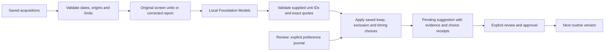

# From observations to a morning

Learn and **Choose mornings** now use the same saved, source-linked pending review for first routines and later updates. Learning begins with explicitly saved evidence; a date on a recording does not establish a complete morning or measured phone use. Recording, importing, retrying and reimporting save evidence without running the model or replacing the current routine.

## The review flow

For a new recording or imported file, review its saved text in Learn. **Confirm this observation** opens the observed-day, time-zone and activity-origin form when information is missing; **Day and source** reopens it later. Native recording can supply its recorded start date/zone, but does not establish human activity. Files and written notes have no inferred observed day. Canceling confirmation leaves saved evidence available. Saving the form does not generate a routine: choose **Suggest a routine** or **Suggest an update** afterward.

For several observations, open **Review → Saved observations → Choose mornings**. Choose one to five dated observations from the same time zone. Personal observations and synthetic samples are separate selections. Unknown or automated activity cannot silently become personal behavior. Both entry points use the same preparation, citation checks and pending proposal below.

The explicit suggestion action asks the local Apple model for supported activities. The resulting sheet shows planned minutes and the observations behind each suggestion. **Done** leaves the suggestion available for later; **Review suggested update** reopens it. **Keep current** discards it, or **Discard** when there is no current routine. **Approve update** saves the approved version for the next morning. Approval does not start playback or grant permission to control another app. Unavailable models, cancellation and failed generation leave the saved evidence and current routine intact.

The existing routine stays unchanged during generation and review. An active or paused morning keeps its original version and blocks replacement. After approval, **Review → Your routine → Restore previous routine** can restore the previous approved version while no morning is active.

```mermaid
stateDiagram-v2
    [*] --> SavedEvidence
    SavedEvidence --> ConfirmProvenance: Missing observed day or origin
    ConfirmProvenance --> SavedEvidence: Save or cancel; no inference
    SavedEvidence --> Preparing: Explicit suggestion from eligible source(s)
    Preparing --> SavedEvidence: Cancel / unavailable / insufficient evidence
    Preparing --> PendingReview: Validate sources and saved choices + save
    PendingReview --> PendingReview: Dismiss / relaunch
    PendingReview --> SavedEvidence: Keep current
    PendingReview --> SavedEvidence: Source, routine or saved choices change
    PendingReview --> ApprovedVersion: Explicit approval + atomic save
    ApprovedVersion --> MorningRun: Separate Start action
```

## What reaches the model

The model receives temporary source-unit identifiers, evidence type and bounded text. Acquisition identities, frame identities, dates and origins remain in an app-owned mapping. Original video evidence keeps its sampled-frame identity through that mapping. A correction replaces the model input for that observation and is labeled as a user report; it is not passed off as unmodified screen text.

Long saved observations are divided into small, serial requests; there is no 8,000-character whole-morning rejection. Each request stays within 1,500 characters and 6,000 UTF-8 bytes including metadata, and the app shows the current part and total. Trusted instructions, schema and output are separate. Every eligible source unit is submitted, with original source/frame identities and exact quotation offsets. Stop analysis cancels without replacing your routine; a failed request never saves a partial suggestion. A defensive 768-request workload ceiling and the existing saved-source bounds remain. Excluded visual material is disclosed, and an observation with no eligible activity evidence is not counted as supporting a proposal. Matching proposed activity titles/categories merge citations, not measured durations. The final plan still permits ten distinct moments (including kept rituals), 512 citations and 32,000 detail characters per moment; an output overflow is explained without silently dropping evidence. Video extraction still samples at most 24 frames and retains bounded OCR, so batching is not proof of complete phone-use coverage. [Long-recording checks](LONG-RECORDING-TEST-PLAN.md) track that separate requirement.

Each inferred moment retains typed citations with acquisition identity, a source revision, source layer, exact quote, character offsets and a sampled-frame identity where applicable. The app assigns dates and origins. The model cannot invent them, approve its own output, mark a ritual required or assign an executable operation. Preserved user decisions have no new inference citations. Model requests use independent sessions; assembly merges only matching normalized titles and categories, combining their citations without computing averages.

## Reviewed screen labels

A sampled screen can have a separate label supplied by you, or an explicit unknown choice. During the next suggestion, a label supplies bounded context alongside that frame's original OCR; it cannot replace the original citation, turn setup/interface text into activity evidence, or claim a read/action/duration. Unknown samples are omitted with **Samples you kept unknown** in the review. If a selected observation has no remaining usable activity evidence, preparation stops before calling the model.

If saved screen reviews are damaged, original-video preparation and older pending proposals are blocked. Adding explicit reviewed notes in Learn supplies a separate user report and permits a new suggestion.

Screen reviews participate in the source revision. Changing or removing one invalidates dependent pending suggestions, including after relaunch. Their original text, frame offsets and quotation checks remain unchanged. This is saved feedback for the next explicit inference, not training or an automatic background update. [Correct a screen](OBSERVED-MORNINGS.md#correct-one-screen).

## Frames that show MORE itself

A recording made in the app starts and ends inside MORE, so some sampled frames show MORE's own screens. Two guards keep them out of a suggestion.

**By time, for a recording made in the app.** While a capture runs, the recorder notes each moment MORE's scene leaves or returns from the background, with one monotonic clock that also times the recording-output start callback. The resulting spans are saved inside the recording's `recordingContext` as seconds after that start, so they follow the recording through the recovery slot and into the saved observation. A sampled frame carries a movie time counted from the start of the file. A frame whose movie time falls inside a span is left out and disclosed with its own reason, `ownInterfaceInFront`; the review counts it under **samples without suitable activity context**.

- The movie's zero and the start callback are assumed close, not measured. Each span is therefore widened by one second on both sides (`OwnInterfaceIntervals.defaultMarginSeconds`), which also covers the system's open and close animation. Both widened bounds are inclusive.
- A scene that is visible but inactive (app switcher, a system sheet over MORE) counts as in front. Only the background state ends a span.
- Spans are final when the file is closed. A span still open then runs to the end of the recording. A return to MORE reported just after capture stopped is kept, because a scene report arrives late and may describe the last frames; at worst it leaves out the last sample of another app. A report handled only after the file is closed is not recorded.
- A scene change just before the start callback keeps its negative time, so the margin still covers a first frame slightly older than the callback.
- Saved spans are part of the observation's source revision: attaching them later makes an earlier pending suggestion stale.
- If the start reading or the scene state is unknown, no span is saved: nothing is excluded by time and only the text rule applies. An unfinished capture lost to a crash has no file to recover, so it has no spans to recover either.

**By text, always.** `OwnInterfaceWording` and `LearningEvidencePolicy` still check every frame, including those of a recording made in the app. Imported recordings, screenshots and recordings saved before spans existed carry no spans and are judged by text alone.

The time guard is covered by package tests with a hand-driven clock. It has not been checked on a phone: whether real scene notifications and real movie times line up within the margin is still to be measured.

## Saved choices in Review

**Review → Your routine** is where the person edits a moment and chooses **Keep in future suggestions** or **Keep this duration**. Changing its minutes turns on the timing choice; it can be switched off before Save. These controls save a separate `RoutinePreferenceJournal`; they do not train the model or turn a personal choice into observed behavior. The journal is applied after the model's proposed activities and exact quotations have been checked.

| Choice | Effect on future suggestions |
| --- | --- |
| Keep in future suggestions | Retains the complete saved moment: identity, title, detail, category, duration, required flag and explicitly selected operation. It can be included even without new supporting observation. Its support is a user decision, with no invented new citations. |
| Keep this duration | Applies the chosen 1–120 planned minutes to a matching suggested activity. By itself it does not insert an absent activity or preserve its generated wording. The generated moment keeps its exact observation citations and receives a separate saved-timing label. |
| Remove from this draft | Removes the current row, while standing future choices remain saved. A retained Keep can therefore add it to a later suggestion. |
| Exclude from future suggestions | Removes the row and saves an exclusion that prevents the matching activity from returning until that choice is cleared. |
| Review → Your routine → Saved choices → Clear this choice | Removes that future preference without editing the current routine or its run history. Later suggestions can reconsider the activity. |

Matching first uses the exact stable target ID, then a unique normalized title and category. Normalization folds case and whitespace; it does not infer synonyms or fuzzy matches. Ambiguous or conflicting matches stop the proposal for review. For a restored generated timing override, the title/category must still match even if a forged row reuses the preference's ID. The saved planned duration is not a measured average.

The current app always supplies its journal, including an explicitly empty one. It therefore does not silently recreate a cleared Keep from an old routine's required flag. Only a legacy workspace with the journal field **missing** migrates its existing personal required steps into Keep entries; demonstration rituals, optional durations and removed activities are not guessed. A present-but-null or malformed journal is preserved through unrelated saves and blocks new suggestions and approval until **Review → Your routine → Saved choices → Reset saved choices** is explicitly confirmed. Reset leaves routines and observations intact. Older shared API callers and proposals with no journal retain their legacy required-step contract; the app's explicit journal is authoritative.

The journal is bounded to 100 entries and 4 MiB encoded data, with no automatic eviction. Keep snapshots retain full saved content; exclusion and duration-only entries retain identity, title/category and the explicit choice. This is a current set of choices, not a complete history of every edit. Clearing a choice or restoring a previous routine does not erase quotations already retained in routines or history, and restoring a routine does not roll back standing future choices.

## What the dates mean

| Statement | Supported interpretation |
| --- | --- |
| “Four observations across three dates” | A description of the selected records, with same-day clips counted once in the date total. |
| A quoted calendar entry appears in a sampled frame | Visible task content; it does not prove the entry was read. |
| “I play chess after checking my calendar” in corrected notes | An explicit user report, distinct from screen evidence. |
| A proposed five-minute moment | Planned time to review, not measured app use or a duration average. |
| An app does not appear in a selected clip | Missing evidence outside the observed samples; not zero use. |

This flow does not produce a habitual frequency, complete-day average, scroll count, message-read count or probability of a preference. Comparable-window reporting has its own [coverage and denominator requirements](OBSERVATION-METRICS.md). Four partial clips do not automatically satisfy four adequate mornings.

## Durability and changes

One pending proposal is saved in the same atomic workspace as its sources and current routine. Full source, base-routine and preference-journal revisions are checked when generation returns, during persistence, after restoration and before approval. The proposal stores the captured journal and its full revision digest. Restoration also replays the preference rules and checks step values and user-choice receipts. Changing corrected text or an individual screen review, deleting a cited observation, changing its day/origin, changing the base routine or editing/clearing a saved choice invalidates the dependent suggestion. A late task cannot restore forgotten evidence.

Approval saves the new approved routine, previous approved version, ready session and removal of the pending proposal together. If saving fails, the previous in-memory values are restored for retry. Rejecting a proposal leaves sources, routine and saved runs intact. Unsupported saved derived proposals are discarded without making original observations or the existing morning unreadable.

Pending citations and the proposal's captured preference snapshot are local derived data. They are removed when the proposal is discarded, invalidated or approved; the standing preference journal remains independently saved. The approved routine retains its step content and embedded quotations; deleting an observation does not erase separately saved routine/history content. There is no automatic expiry, cloud upload or model training from these records. See the [retention table](ARCHITECTURE.md#data-retention-today) for other stored data.

## Verification boundary

The saved-choice source (`4022a0e`) passed the full shared run: **259 checks passed and six optional checks skipped**. Five preference/recovery simulator journeys have passing results across scoped runs, with earlier selector failures retained in [PHASE-ONE](PHASE-ONE.md). Simulator and signed iPhone builds passed; the signed build is ready but not installed. These checks made no model calls and do not establish physical capture or audio behavior.

The unified Learn/import/provenance slice (`48e5c95`) passed the full shared package run: **235 checks passed and six optional checks skipped**. Simulator and unsigned iPhone builds passed. **Three UI journeys passed with no skips**: import preservation through relaunch; explicit provenance followed by a single-source pending suggestion, approval and relaunch; and rejection of setup-only input. No Apple model calls were made in this slice. Two additional notice-review journeys have passing results after the final routing changes: immediate review and review deferred until a paused morning ends after a blank-video error. These five journeys passed across scoped runs; earlier failures and corrected reruns remain in the verification record.

The preceding saved-mornings slice at `4a2fd30` retains its six passing synthetic journeys across scoped runs, including the initial offscreen-discard failure and corrected footer/layout reruns in [verification](PHASE-ONE.md). A deterministic suggestion used by a UI test is explicitly labeled and is not an Apple model result. Normal app launches never use it as a fallback.

Actual model generation and proposal quality still require a ready model on supported hardware. A fresh physical-device query at **2026-10-10 00:27:21 UTC found no phones**. Model readiness was not re-probed; the prior Mac `modelNotReady` result and unsupported simulator backend remain historical findings. The current UI has not been installed on a physical phone, and capture, microphone/audio and route behavior need their own checks. Exact runs and failures are recorded in [PHASE-ONE](PHASE-ONE.md).

Relevant work remains in [#11 — multi-day routine versions](https://github.com/gibouu/morning-operator/issues/11), [#21 — observation analytics](https://github.com/gibouu/morning-operator/issues/21) and [#23 — controlled recording benchmark](https://github.com/gibouu/morning-operator/issues/23).
