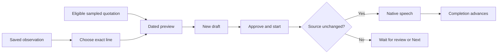

# A saved moment, spoken

Choose a short excerpt from an observation and hear it again as part of your approved morning. MORE speaks the observed day with the quotation, so a historical screen cannot quietly become today's inbox.

This is a native source-backed narration path in the V2 branch. It does not connect to WhatsApp, fetch email, operate another app or generate a conversational summary. [Your day](YOUR-DAY.md) remains the separate current-calendar/weather recap.

## Try it

1. In **Review → Saved observations**, open an observation and choose **Read a saved moment**.
2. Select a complete short line. The preview shows the exact sentence MORE will speak, including the date. Its original time zone stays visible.
3. Choose **Hear preview**. **Stop** ends only this preview; leaving the screen stops it too. Check your chosen voice and output in Settings if needed.
4. Choose **Add to my morning**, then review and approve the new draft. Adding never approves the routine.
5. Enable spoken guidance and Hands free when you want supported moments to progress automatically. Start the morning. The saved moment completes only when native speech reports completion; manual activities still wait for you.

From an individual sampled screen, **Read this saved moment** opens the same preview with its exact quotation selected. This shortcut is offered only for an eligible complete line from that exact frame. It does not pick a similar line, open the microphone or begin playback. If the source changed before presentation, the selection is refused; choose again from the current source.

An observation needs a confirmed day and personal or synthetic origin. Original video excerpts come from successful, untruncated OCR frames. A written correction supplies its own note text instead. The chooser offers up to 24 complete lines, each at most 500 characters and 4,000 UTF-8 bytes; longer or incomplete lines are skipped, never silently shortened. Choosing a quotation does not establish that you opened, read, replied to or liked anything.

The excerpt's wording stays fixed in the routine editor. A different excerpt comes from its observation in Review. Explicitly switching the action to **Read this text aloud** makes the content an ordinary static note and removes its source binding.

## From evidence to speech

`ObservationNarrationComposer` produces one deterministic sentence for display and speech. `RoutineObservationReference` retains acquisition ID, source revision, optional frame ID and exact quote. `MorningAppStepExecutor` resolves that reference against the current local archive on every play and repeat, and compares the result with the approved sentence byte for byte. Deleted sources, corrected text, reassigned dates/origins, changed evidence or substituted sentence text block playback. A failure never falls back to reading stale `step.detail`.

The source revision covers original/corrected text, date, origin, extraction and recording metadata. Derived model classifications do not authorize narration. Model-generated steps cannot carry an executable binding; explicitly kept user choices can retain one. This path makes no Foundation Models request and is available independently of local model readiness.

Preview playback owns an utterance ID, so dismissing an old preview cannot stop newer speech. Session execution uses existing cancellation, pause, skip and repeat controls. No microphone opens merely because a quotation finishes. [Explicit voice commands](VOICE.md) and the completion reflection remain separate flows.

## What stays on the device

The selected quote and dated sentence become part of the routine and can also survive in previous versions, saved runs or explicit keep choices. Deleting the original observation blocks source-backed replay; it does **not** erase those other copies. Full forgetting removes app-owned copies through [Privacy](PRIVACY.md). Portable export omits source IDs/bindings, but an export with notes includes the saved sentence and quotation; exported routines return as manual drafts.

A routine containing a synthetic excerpt is marked synthetic, including an otherwise personal draft with a sample added. That provenance survives an explicit keep choice and later proposals based on personal observations, even if the routine label changes. Its runs stay out of personal time averages. No raw recording, OCR archive or source fingerprint is uploaded by this feature.

## Validation and remaining work

The scoped verification record is in [PHASE-ONE](PHASE-ONE.md). Shared checks cover byte-exact quotations, source mutation/deletion, legacy decoding, proposal/import boundaries and cancellation. Native journeys use clearly labeled synthetic observations; they establish neither real OCR accuracy nor listener audibility.

This is one reviewed historical excerpt at a time. Automatic relevant-message selection, fresh inbox connectors, synthesis of an entire observed morning, live screen-grounded actions, background preparation guarantees, natural barge-in and hardware route quality remain separate work. Do not describe a passing speech callback as proof that a listener heard the audio.
