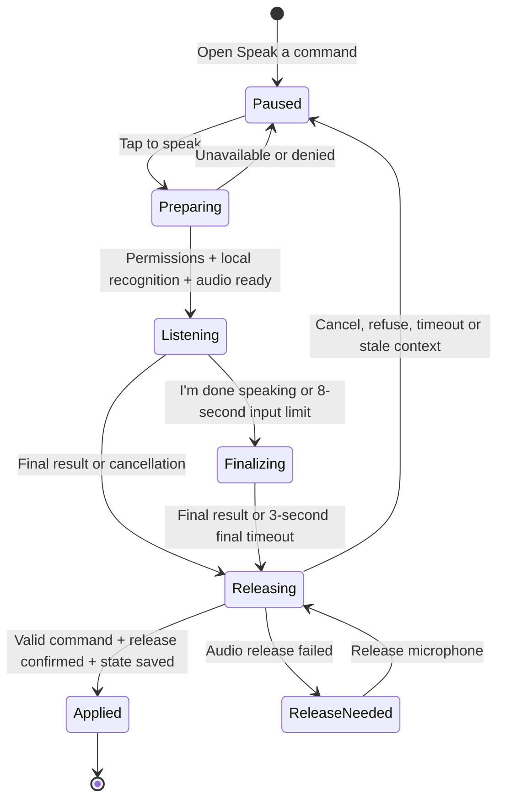

# Voice with MORE

MORE uses native system speech for approved notes, selected historical excerpts and prepared Calendar/Weather recaps. Command input and spoken capture each require an explicit listening turn. There is no continuously listening custom wake word.

Physical microphone recognition, HomePod routing and listener-confirmed speech quality remain open. An earlier phone greeting reached speech completion, but the owner did not confirm hearing it. [Verification](PHASE-ONE.md) separates native simulator speech callbacks, injected text tests and actual phone evidence.

## Use it

1. Start an approved routine. Open **Morning controls → Speak a command**. MORE pauses the run and cancels its current automatic operation.
2. Choose **English** or **Français**, then **Tap to speak**. The app stops and releases its speech output before preparing the microphone. It requests Speech and microphone access when needed.
3. Wait for **Listening for one command…**, then say one command from the table below. The sheet shows the current microphone route and a temporary transcript. You may say “MORE next” or “MORE suivant”; MORE is an optional prefix during this turn, not a background wake word.
4. Tap **I'm done speaking** to finish input early, or let the eight-second input limit finish it. MORE waits for a final recognition result, releases the microphone, checks that the same routine step is still active, then applies one accepted command.

**Close cancels listening and leaves the morning paused.** “I'm done speaking” allows a final command to be accepted. Saying **stop**, or choosing **End morning** in Morning controls, ends the routine. A canceled or refused turn does not resume the routine automatically; close the sheet and use the ordinary routine controls.

## Capture something after your morning

After the final routine step completes and that transition is saved, Morning offers **Speak**, **Write** and **Not now**. With read-aloud enabled, MORE can say one brief invitation to keep a thought, dream or reminder. The invitation waits until Morning is active and no conflicting sheet or operation owns the interaction. It is queued once for that newly completed session; loading a completed session after relaunch does not replay it. Stopped mornings do not queue it. The selected speech voice determines whether the invitation is spoken in English or French.

The invitation never opens the microphone. **Speak is the explicit request to begin one capture turn**: it opens the capture sheet, stops and releases speech output, requests permissions if needed, then prepares on-device recognition. This sheet starts the requested turn when it appears; no second start tap is required. **Write** opens the ordinary editable capture form. **Not now** dismisses the reflection choices for the current in-memory session and stops any owned invitation or capture turn.

Speak naturally in English or French. The initial recognition language follows the app's current locale; after a turn ends or is refused, the language selector and **Try speaking again** allow another explicit attempt. Input is limited to **30 seconds**, followed by at most **3 seconds** for a final result. **I'm done speaking** ends input early and allows a final result; **Cancel** discards the turn. Setup, permission dialogs and microphone release are outside those limits. No audio file is kept.

Dictation is a separate mode from routine commands. It uses Apple's dictation hint and punctuation, without the command phrase hints or parser. Saying “next”, “stop” or “remind me” during capture returns words for review; it never advances a routine or creates an Apple item. Only the first final transcript is accepted. Empty text or text longer than 4,000 Characters is refused rather than silently truncated; punctuation and content are retained apart from outer whitespace.

After microphone release is confirmed, the capture sheet closes and the normal **Catch the thought** editor opens. The existing deterministic parser may suggest Dream, Thought, Reminder or Calendar and a time from supported phrases. Check and edit the words, category and date. **Save my dream** or **Save thought** saves locally; **Add to Reminders** or **Add to Calendar** is an explicit external write after reviewing the destination and time. The Apple-app toggle can instead keep a reminder/calendar idea as a local note. Recognition itself saves nothing, and canceling review creates no item. Saved captures from this path carry the source label **Spoken with MORE**. Existing receipt safeguards still apply to an unconfirmed Apple-app write; check that app before retrying.

The completed-session ID and a fresh attempt ID are checked after speech shutdown and again after recognition. Backgrounding, closing capture or replacing the session invalidates the handoff; a late result cannot open review for a different morning. A shared release barrier waits for canceled permission/setup owners to settle before allowing a new command, dictation turn or app playback. **Release microphone** retries cleanup after a release failure. It does not start another recognition attempt.

## Supported commands

These are exact phrases after normalization of case, accents and punctuation. The language picker configures recognition for `en-US` or `fr-FR`; the parser accepts the listed English and French phrases. One optional leading “MORE” is allowed.

| Command | English phrases | French phrases | Effect |
|---|---|---|---|
| Next | next; next step | suivant; étape suivante | Mark the current step complete and advance once. Resume the run if another step remains; the last step completes the run. |
| Pause | pause; pause morning | pause; mets en pause | Keep the run paused. |
| Resume | resume; continue; resume morning | reprends; reprendre; continuer | Resume the current step using its existing supported operation, if enabled. |
| Skip | skip; skip step; skip this step | passe cette étape; passer cette étape | Mark the current step skipped and advance once. Resume if another step remains. |
| Repeat | repeat; repeat that; repeat this step; again; read again | répète; répéter; répète cette étape | Repeat the current supported read using its source checks; keep the run paused. |
| Stop | stop; stop morning | arrête; arrêter; arrête la routine | End the run. This is different from canceling the microphone turn. |

This is a command grammar, not conversational intent inference. “Don't go next”, “next and stop”, “send a message” and “MORE” alone are refused when recognized as those phrases. Partial transcripts never dispatch actions. The first final result is considered once; every supplied recognition alternative must resolve to the same command. Recognition can still mishear a person: the grammar does not authenticate a speaker or identify recorded speech.

## A single listening turn

The eight-second limit starts when audio capture starts. After input ends, the recognizer has up to three more seconds to return a final result. Permission dialogs, setup and audio cleanup are outside those limits, so eleven seconds is not a total-turn guarantee. A final result may arrive earlier.

Opening the sheet pauses first. Before listening, the store awaits speech-output shutdown. It blocks playback and overlapping turns while input is preparing, active, finalizing or still owns the audio session. After input finishes, it releases that session before returning a command. An unresolved release shows **Release microphone**; that button retries cleanup, not recognition. The run stays paused while release is unresolved.

An actual microphone-input route change while listening, an audio interruption, app backgrounding or closing the sheet cancels the turn. Late callbacks cannot apply a canceled turn. An accepted command is pinned to a session, routine version and step, and its turn ID prevents duplicate application. The resulting session state is saved before resumed speech or automatic work is dispatched. This does not add new cross-app automation capabilities.

## Processing and privacy

Both listening modes share Apple's Speech framework and an in-memory `AVAudioEngine` input stream. They require a recognizer that reports on-device support and `requiresOnDeviceRecognition = true`. If the language or local recognizer is unavailable, MORE refuses listening and offers routine buttons or typing; it does not fall back to server recognition. This native listener is implemented for iOS; other platforms show an unavailable result. [Apple: on-device support](https://developer.apple.com/documentation/speech/sfspeechrecognizer/supportsondevicerecognition), [requiring on-device recognition](https://developer.apple.com/documentation/speech/sfspeechrecognitionrequest/requiresondevicerecognition).

The listener writes no microphone audio file or transcript. Temporary transcripts are memory-only; cancellation clears them, failed capture clears them, and a new turn replaces them. The shared capture transcript and completed cleanup reference are released at final handoff. Successful capture text is handed to an editable draft and becomes a saved note only through the explicit save flow. A command saves only the resulting ordinary routine state/events. Neither mode automatically adds habit-training examples or makes a model-training request. A saved reminder/calendar item can sync through the user's Apple account, as disclosed in its review form.

Speech and microphone permission are requested by the explicit listening action, not by opening Morning. Denial or unavailable recognition leaves touch controls usable. Microphone permission belongs to Apple's app-level audio permission flow; recognition availability can vary by device and language. [Apple: microphone permission](https://developer.apple.com/documentation/avfaudio/avaudioapplication/requestrecordpermission(completionhandler:)), [recognizer availability](https://developer.apple.com/documentation/speech/sfspeechrecognizer/isavailable).

The listener observes Apple's audio route and interruption notifications to cancel input safely. This implementation uses `SFSpeechRecognizer`; it does not yet use `SpeechAnalyzer`. [Apple: route changes](https://developer.apple.com/documentation/avfaudio/avaudiosession/routechangenotification), [audio interruptions](https://developer.apple.com/documentation/avfaudio/avaudiosession/interruptionnotification).

## Physical-phone acceptance script

**All listener checks below are pending until recorded against a named installed build.** Use an approved synthetic routine with three harmless manual steps, no external writes and automatic read-aloud initially off. Record source revision, iPhone/iOS, selected language, microphone route and actual outcomes. Do not treat a simulator build, injected transcript, unit test or TTS completion callback as a microphone pass.

| Check | Procedure and required outcome |
|---|---|
| Entry and consent | Start the synthetic routine, open Morning controls → Speak a command, and verify the run pauses. No microphone turn starts until Tap to speak. On a fresh permission state, observe the system prompts. Test denial separately: no advance or speech, a clear fallback, and ordinary buttons still work. |
| One command | Select English, tap, wait for Listening, say “next”, then tap I'm done speaking. Confirm exactly one completion and the next step. Restart a clean synthetic run and repeat for each command; verify skip versus complete, repeat while paused, and stop as a terminal state. |
| French and prefix | Select Français and exercise the displayed French commands. Test “MORE suivant” during an active turn. Saying MORE before tapping must not start a turn; saying MORE alone during a turn must not run a command. |
| Refusal | In separate turns say “don't go next”, “next and stop” and “send a message”. Confirm the recognized text and no routine action. If recognition changes the words into an allowed command, record a recognition failure, not a successful refusal. Pause after “next” within a longer sentence and verify no partial result advances the routine. |
| Silence and cancellation | Stay silent: capture ends at its limit and no command is applied without a valid final result. Close during preparation, listening and finalization; wait beyond the final timeout and confirm no late action. Contrast this with I'm done speaking, which may accept the final command. |
| Permissions and offline capability | Test denied Speech access and denied microphone access independently, then restore access. With the required local language support available, test an offline turn. If on-device support is absent, the expected outcome is refusal and touch fallback, never a server fallback. |
| Audio handoff | Start reading a harmless step aloud, then open the voice sheet and tap to speak. Output must stop before microphone capture; it must not recognize its own spoken step as a command. After a successful repeat, verify microphone release and ask a human listener to confirm the actual audio. |
| Route and lifecycle | During listening, change the actual microphone route, background the app, and cause an audio interruption in separate trials. Each must cancel without a late command. Return and verify a new explicit turn works; if release fails, playback remains blocked until cleanup succeeds. |
| Repeated controls | Tap finish or cancel repeatedly during one turn. There must be no duplicate step completion, overlapping listener or stale result applied to a later step. Context and duplicate guards also need their deterministic regression tests. |
| Cancel versus end | Close a listening turn and verify the run remains paused and resumable. Separately say “stop”, and separately choose End morning: each must end the run, not merely hide the sheet. |
| Completion invitation | Finish a harmless synthetic routine with read-aloud on. A human confirms the invitation is audible once; no microphone starts. Relaunch the completed session and confirm no replay. Repeat with read-aloud off and verify the visible Speak/Write/Not now choices remain usable. |
| Spoken capture and review | Tap Speak after completion. Say a synthetic dream, finish, edit the resulting review text and save explicitly. Relaunch and verify the edited text and Spoken with MORE source. In a separate turn say “stop”: it must appear as text for review, with no routine command or automatic save. |
| Capture cancellation and bounds | Cancel during preparation, listening and finalization; background in a separate trial. Confirm no delayed review or saved note, then try a fresh turn. Verify the 30-second input boundary and finalization timeout, local-unavailable typing fallback, and safe release before subsequent playback. Pure policy tests cover the exact character bound separately. |

Keep any diagnostic transcripts synthetic and any device artifacts private. Log pass, failure and unavailable/skipped checks separately. A supported-command demonstration does not establish general conversational accuracy, speaker authentication or reliable use in noisy rooms.

## Still ahead

Always-listening MORE detection, conversational interruptions, open-ended dialogue, fresh inbox preparation and HomePod microphone input remain future work. Bounded dictation for explicit capture is implemented in this branch; it is not a continuous conversation or a background wake word. The existing Siri capture entry and spoken-output voice chooser remain separate features. Personal Voice, Siri voices and custom voices are not offered; the [voice audit](VOICE-AUDIT.md) records why and what each would require. A future inbox recap needs connected source data, source timestamps and freshness rules; hearing a command or capturing a thought does not grant access to messages, health data or another app's interface.

Implementation: [command sheet](../Sources/MorningOperator/MorningVoiceCommandView.swift), [capture sheet](../Sources/MorningOperator/MorningCaptureVoiceView.swift), [editable capture review](../Sources/MorningOperator/QuickCaptureView.swift), [store orchestration](../Sources/MorningOperator/MorningStore.swift), [shared listener](../Sources/MorningApple/MorningVoiceCommandListener.swift), [strict command grammar](../Sources/MorningCore/MorningVoiceCommand.swift), [bounded capture policy](../Sources/MorningCore/MorningCaptureTurn.swift). Related work: [voice #4](https://github.com/gibouu/morning-operator/issues/4), [V2 #25](https://github.com/gibouu/morning-operator/issues/25).

### Prepared calendar and weather speech

The V2 [Your day](YOUR-DAY.md) operation supplies exactly the prepared sentences shown on screen. Repeat preserves the current moment's facts while valid; an expired recap requires an explicit update. Preview refresh never advances a routine. This uses system speech and deterministic source formatting, with no local or remote model rewriting the facts. Actual listener audibility remains unconfirmed.

### Historical excerpts in a routine

[Saved moments](SAVED-MOMENTS.md) lets the person select one exact line from a dated observation, hear a preview and add it as an unapproved routine step. The spoken sentence includes its date. Native synthesis completion can advance the approved step; changing or deleting its source blocks replay instead of speaking a stale stored copy. This is deterministic quotation, not model-generated summary or live message access.
